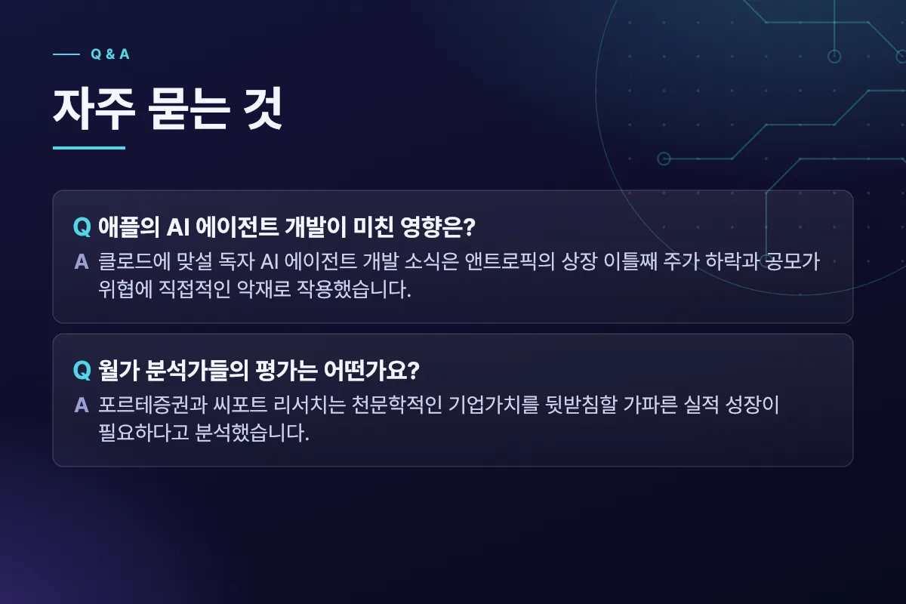
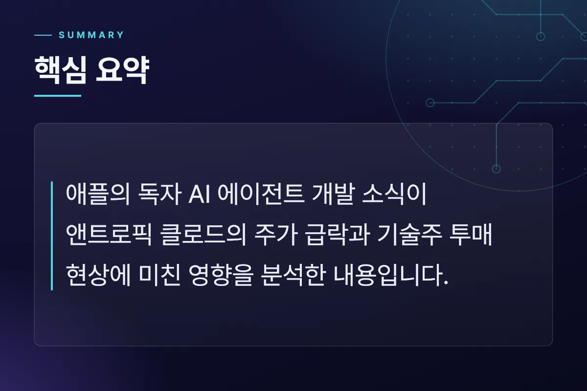
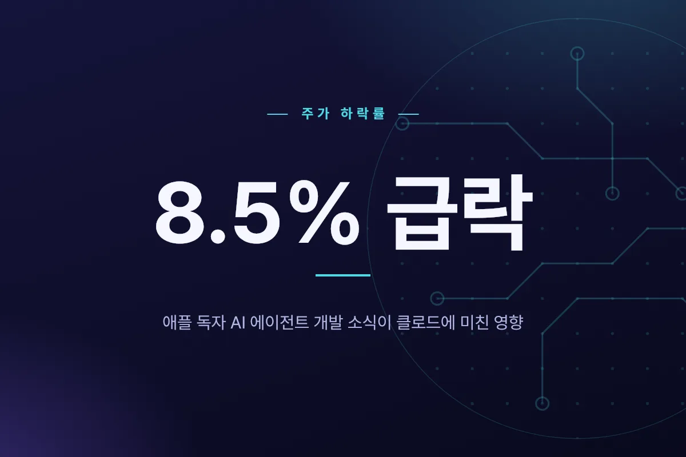

2026년 11월 21일 기준, 애플이 앤트로픽의 인공지능 모델인 클로드에 맞설 독자 AI 에이전트를 개발 중이라는 소식이 전해지면서 글로벌 기술주 전반에 거센 후폭풍이 불어 닥치고 있습니다. 연합뉴스, SBS, 한국경제, YTN, 디지털타임스 등 주요 언론 보도에 따르면, 이러한 개발 소식은 상장 이틀째를 맞이한 앤트로픽의 주가가 8.5% 급락하며 장중 공모가 선까지 위협받는 직접적인 악재로 작용했습니다. 인공지능 인프라 투자 과열에 대한 시장의 회의론까지 복합적으로 맞물리면서 뉴욕증시 전반의 투자 심리를 급격히 얼어붙게 만들었습니다.

애플의 독자 AI 에이전트 개발 착수는 단순히 개별 기업 간의 제품 경쟁을 넘어, 거대 플랫폼 기업들이 AI 생태계의 주도권을 쥐기 위해 얼마나 공격적으로 움직이고 있는지를 보여주는 상징적인 사건입니다. 포르테증권의 이매뉴얼 발라바니스 분석가는 블룸버그 통신과의 인터뷰에서 애플의 이러한 행보가 앤트로픽뿐만 아니라 광범위한 AI 및 기술주 전반에 상당한 부담으로 작용하고 있다고 진단했습니다. 시장 참여자들은 그동안 클로드가 확보해 온 독보적인 기술적 우위와 성장 기대감에 대형 제조사의 자체 생태계 구축이라는 거대한 변수가 더해진 상황을 예의주시하고 있습니다.

<figure>

<figcaption>자주 묻는 것</figcaption>
</figure>

이처럼 시장이 민감하게 반응하는 기저에는 인공지능 기업들이 평가받아 온 천문학적인 기업가치가 과연 실질적인 실적과 수익으로 증명될 수 있는가에 대한 월가의 엄격한 검증 잣대가 자리 잡고 있습니다. 씨포트 리서치를 비롯한 주요 투자 기관들은 앤트로픽에 대해 '중립' 투자의견을 제시하며, 현재 형성된 막대한 기업가치를 시장에서 온전히 정당화하려면 앞으로 수년간 가파른 실적 성장이 필수적으로 동반되어야 한다고 지적했습니다. 기술주 전반에 퍼진 투매 현상은 단순한 단기 조정 장세를 넘어, 인공지능 산업 전반의 수익 창출 능력을 재평가하려는 투자자들의 냉정한 현실 인식을 반영한 결과로 풀이됩니다.

| 구분 | 주요 내용 및 현황 | 시장 반응 및 분석 |
| :--- | :--- | :--- |
| 애플의 개발 동향 | 클로드에 맞설 독자 AI 에이전트 개발 추진 | AI 및 기술주 전반의 투자 심리에 직접적인 악재로 작용 |
| 앤트로픽 주가 추이 | 상장 이틀째 8.5% 급락 및 공모가 선 위협 | 신규 상장 종목의 변동성 확대와 하방 압력 심화 |
| 월가 주요 평가 | 천문학적인 기업가치에 대한 실적 검증 요구 | 씨포트 리서치 등 주요 기관에서 투자의견 '중립' 제시 |
| 거시 시장 환경 | 인공지능 인프라 투자 과열에 대한 회의론 대두 | 기술주 투매 현상과 맞물려 나스닥 전반의 약세 유발 |

애플의 진입 소식이 앤트로픽의 클로드에 미친 타격은 인공지능 시장의 권력 구조가 어떻게 재편될 수 있는지를 단적으로 보여줍니다. 연합뉴스는 2026년 11월 21일 보도를 통해 애플의 독자 AI 에이전트 개발 계획이 빅테크 기업 간의 주도권 경쟁을 한층 더 격화시키는 동시에, 갓 상장한 선도적 AI 기업의 주가 방어력을 시험대에 올렸다고 평가했습니다. 대형 플랫폼 기업들이 자체 에이전트를 통해 사용자를 자사 생태계에 묶어둘 경우, 외부 AI 모델 제공업체들이 겪어야 할 영업 환경의 변화는 피할 수 없는 과제가 됩니다.

투자 시장에서는 인공지능 기술의 고도화 속도만큼이나, 플랫폼 기반의 수익화 모델이 실물 경제에서 얼마나 실효성을 거두는지가 핵심 평가 기준로 부상했습니다. 씨포트 리서치의 분석처럼 현재의 높은 밸류에이션이 거품이라는 우려를 지우기 위해서는, 앤트로픽을 비롯한 AI 전문 기업들이 클로드의 뛰어난 성능을 실제 매출 성장으로 치환해 내는 과정을 숫자로 증명해야 합니다. 이번 주가 급락은 기술력만으로는 시장의 높은 기대치를 영원히 만족시킬 수 없으며, 거대 제조사의 진입이라는 실질적 위협 앞에서 지속 가능성을 증명해야 하는 무거운 숙점을 남겼습니다.

<figure>

<figcaption>핵심 요약</figcaption>
</figure>

## 자주 묻는 질문

**Q. 애플의 AI 에이전트 개발이 클로드에 미친 영향은 무엇인가요?**

애플이 클로드에 맞설 독자 AI 에이전트를 개발 중이라는 소식이 전해지면서 앤트로픽의 주가와 기업가치에 직접적인 악재로 작용했습니다. 월가에서는 천문학적인 기업가치가 정당화되기 위해 앞으로 수년간 가파른 실적 성장이 뒷받침되어야 한다고 분석했습니다.

**Q. 뉴욕증시에서 앤트로픽 주가는 어떻게 움직였나요?**

앤트로픽은 상장 이틀째 8.5% 급락하며 장중 공모가 선까지 위협받는 약세를 보였습니다. 인공지능 인프라 투자 과열에 대한 시장의 회의론과 기술주 전반의 투매 현상이 맞물린 결과입니다.

**Q. 월가 분석가들은 현재 상황을 어떻게 진단하고 있나요?**

포르테증권과 씨포트 리서치 등 주요 기관은 이번 소식이 앤트로픽뿐만 아니라 광범위한 AI 기술주에 큰 부담을 준다고 평가했습니다. 특히 현재 형성된 높은 기업가치를 유지하기 위해서는 실질적인 실적 성장을 통해 시장의 우려를 불식시켜야 한다고 지적했습니다.

<figure>

<figcaption>주가 하락률: 8.5% 급락</figcaption>
</figure>

2026년 11월 21일 현재, 애플의 독자 AI 에이전트 개발 보도는 인공지능 산업의 경쟁 구도 변화가 개별 기업의 주가에 얼마나 즉각적인 타격을 줄 수 있는지 명확히 보여주었습니다. 앤트로픽의 클로드가 직면한 이번 주가 급락은 단순한 시장의 일시적 노이즈인지, 혹은 고평가 논란의 본격적인 서막인지에 대해 투자자들의 이목이 집중되는 형국입니다. 향후 대형 플랫폼들의 자체 AI 생태계 구축 진척도와 AI 전문 기업들의 실적 증명 여부가 기술주 전반의 중장기 향방을 결정할 핵심 변수로 작용할 전망입니다.

## 참고한 자료

- [앤트로픽, 상장 이틀째 8.5% '급락'…장중 공모가까지 위협](https://www.slist.kr/news/articleView.html?idxno=783564) — slist.kr, 2026-11-21 보도
- [앤트로픽, 상장 이틀째 8.5% 급락…장중 공모가까지 떨어져](https://biz.sbs.co.kr/article_hub/20000347951?division=NAVER) — SBS, 2026-11-21 보도
- ["믿었던 AI마저"…기술주 투매에 나스닥 5% 급락 뉴욕증시 브리핑](https://www.hankyung.com/article/2026112110837) — 한국경제, 2026-11-21 보도
- [앤트로픽, 상장 이틀째 8.5% 급락...장중 공모가 선까지 위협](https://www.ytn.co.kr/_ln/0104_202611210717108059) — YTN, 2026-11-21 보도
- [앤트로픽, 8.5% 급락… 장중 공모가까지 떨어지기도](https://www.dt.co.kr/article/12096380?ref=naver) — dt.co.kr, 2026-11-21 보도
- [앤트로픽, 상장 이틀째 8.5% 급락…장중 공모가까지 떨어지기도](https://www.yna.co.kr/view/AKR20261121011100091?input=1195m) — 연합뉴스, 2026-11-21 보도

2026년 11월 21일 기준으로 정리했습니다. 일정이나 금액처럼 바뀔 수 있는 내용은 위 참고 자료에서 한 번 더 확인해 주세요.
