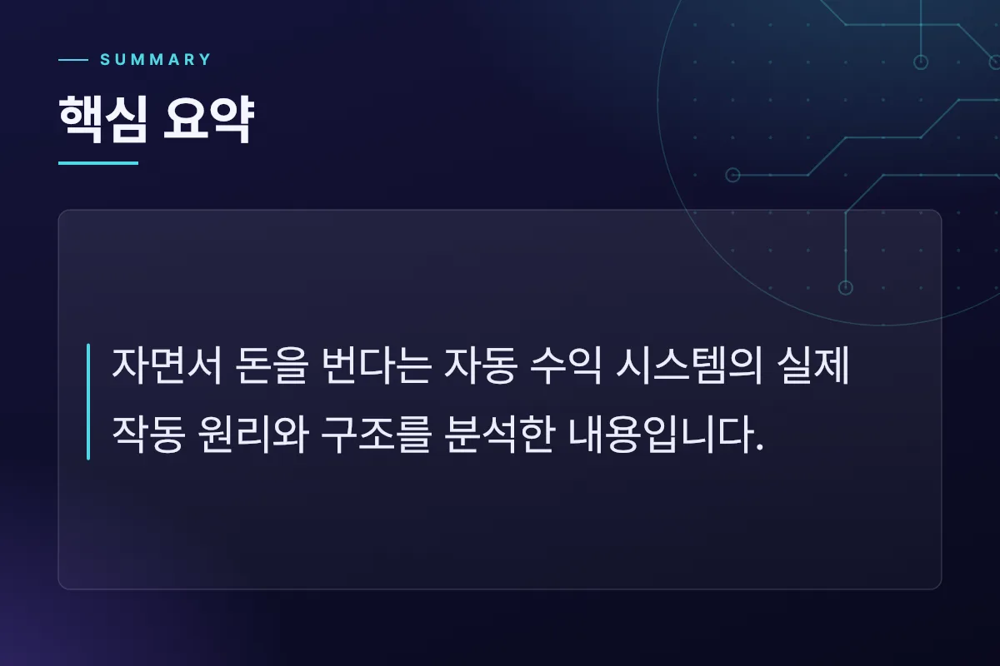
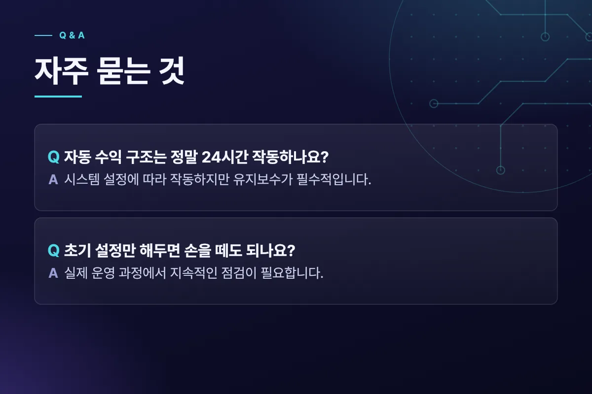

2026년 11월 18일 기준으로, 눈을 감고 자고 있는 동안에도 통장에 돈이 쌓인다는 말은 많은 사람들의 이목을 사로잡습니다. 하지만 과연 그러한 자동 수익이 실제로 어떠한 물리적·디지털 구조를 거쳐 굴러가는지 명확하게 아는 이는 드뭅니다. 인터넷상에서 흔히 접할 수 있는 화려한 문구들과는 달리, 실제 시스템이 작동하는 방식에는 여러 단계의 복잡한 연결 고리가 존재합니다. 이 글에서는 자면서 돈이 벌린다는 그 구조의 실체를 차근차근 뜯어보고, 눈에 보이는 수익 뒤편에 숨겨진 작동 원리를 짚어봅니다.

<figure>

<figcaption>자동 수익 구조를 설명하기 위한 개념 시각화 이미지 (사진: https://click.gl/RSs7nB)</figcaption>
</figure>

## 수익이 자동으로 발생한다고 주장하는 배경

사람들이 자동 수익에 대해 이야기할 때 가장 먼저 언급하는 것은 디지털 자산이나 콘텐츠의 파이프라인 개념입니다. 한번 만들어 두면 물리적인 노동을 지속해서 투입하지 않아도 트래픽이나 거래가 발생하여 수익이 창출된다는 논리입니다. 예를 들어 자동화된 프로그램이나 웹사이트가 사용자의 개입 없이 특정 작업을 수행하는 형태가 이에 해당합니다. 그러나 이러한 시스템이 원활하게 돌아가기 위해서는 초기에 상당한 양의 데이터 입력이나 설정 과정이 선행되어야 합니다. 단순히 방치해 둔다고 해서 저절로 돈이 복사되는 것은 아니며, 보이지 않는 곳에서 서버가 유지되거나 알고리즘이 작동하는 물리적 기반이 필요합니다.

<figure>

<figcaption>시스템의 작동 흐름도를 보여주는 요약 카드</figcaption>
</figure>

## 실제 구조를 지탱하는 핵심 요소와 한계

자동 수익 구조를 깊이 들여다보면, 그 핵심에는 데이터 처리와 트래픽 유입이라는 두 가지 축이 자리 잡고 있습니다. 시스템이 스스로 작동하기 위해서는 외부의 요인, 즉 방문자의 유입이나 시장의 변동성이 끊임없이 공급되어야 합니다. 만약 이 공급 고리가 끊어지면 자동 수익이라 불리던 흐름도 순식간에 멈춰 서게 됩니다. 또한, 플랫폼의 정책 변화나 기술적인 오류 발생 시 이를 실시간으로 감지하고 수정하는 주체가 있어야 하는데, 완전한 무인 상태에서는 이러한 돌발 상황에 대처하기 어렵습니다. 따라서 '자면서 번다'는 표현은 노동의 시간이 시차를 두고 분산되는 것일 뿐, 시스템 자체를 구축하고 관리하는 총량의 법칙은 여전히 유효하다고 볼 수 있습니다.

<figure>

<figcaption>자주 묻는 질문들을 모아둔 FAQ 카드</figcaption>
</figure>

## 자금 흐름과 정산 과정에서 발생하는 변수

수익이 발생한다는 구조를 이해하는 것만큼이나 중요한 것은 실제로 그 자금이 내 손에 들어오는 정산의 메커니즘입니다. 대개의 자동 수익 모델은 제3자 플랫폼이나 결제 대행사를 거쳐 최종 정산이 이루어지므로, 각 서비스 제공사의 수수료 정책이나 지급 주기 규정을 면밀히 살펴야 합니다. 이 과정에서 환율 변동이나 국가별 세무 처리 방식, 플랫폼의 이용 약관 변경 등 예상치 못한 변수들이 수익의 실효성에 직접적인 영향을 미치게 됩니다. 수익 숫자가 화면에 찍히는 것과 실제 통장 잔고로 입금되는 것 사이에는 여러 단계의 기술적·행정적 검증 절차가 존재한다는 점을 간과해서는 안 됩니다.

## 시스템 유지보수와 지속 가능성의 문제

자동으로 굴러간다고 소개되는 많은 시스템들이 시간이 지남에 따라 효율이 떨어지거나 작동을 멈추는 이유는 유지보수의 부재에 있습니다. 디지털 환경은 끊임없이 진화하며, 보안 규격이 바뀌거나 연동된 API가 폐기되는 등의 변화가 빈번하게 일어납니다. 초기에 정교하게 설정해 둔 구조라 할지라도 정기적인 업데이트나 점검이 이루어지지 않으면 머지않아 오류를 일으키기 마련입니다. 결국 지속적인 수익을 유지하기 위해서는 시스템을 방치하는 것이 아니라, 주기적으로 상태를 모니터링하고 수정하는 관리 작업이 필수적으로 동반되어야 합니다.

<figure>

<figcaption>자면서 돈 벌린다는 자동 수익, 진짜 굴러가는 구조인지 뜯어봤습니다 (사진: https://click.gl/RSs7nB)</figcaption>
</figure>

## 자주 묻는 질문

**자동 수익 구조는 정말 24시간 작동하나요?**

시스템 설정에 따라 서버나 프로그램은 상시 가동될 수 있지만, 외부 트래픽이나 오류 발생 시 이를 통제하는 관리자의 개입이 없으면 정상적인 수익 창출이 지속되기 어렵습니다.

**초기 설정만 해두면 손을 떼도 되나요?**

실제 운영 과정에서는 플랫폼의 정책 변화나 기술적 환경의 변동에 대응하기 위한 지속적인 점검과 유지보수가 필수적입니다.

<figure>

<figcaption>자면서 돈 벌린다는 자동 수익, 진짜 굴러가는 구조인지 뜯어봤습니다 (사진: https://click.gl/RSs7nB)</figcaption>
</figure>

## 마무리하며

자면서 돈이 벌린다는 자동 수익의 실체는 마법 같은 무중력 상태가 아니라, 철저하게 설계된 디지털 파이프라인과 지속적인 관리의 결합물입니다. 눈에 보이지 않는 곳에서 수많은 조건들이 맞물려 돌아가야만 비로소 결과물이 만들어지며, 이 과정에는 예상치 못한 기술적 한계와 외부 변수들이 상시 존재합니다. 따라서 화려한 수식어 뒤에 숨겨진 실제 작동 구조와 유지의 실상을 차분히 바라보는 태도가 무엇보다 중요합니다.
아래 링크확인을 통해 자면서 수익화 가능한 방법을 정리 했습니다.
[관련 링크 확인하기](https://click.gl/RSs7nB)

2026년 11월 18일 기준으로 정리했습니다. 일정이나 금액처럼 바뀔 수 있는 내용은 위 참고 자료에서 한 번 더 확인해 주세요.
