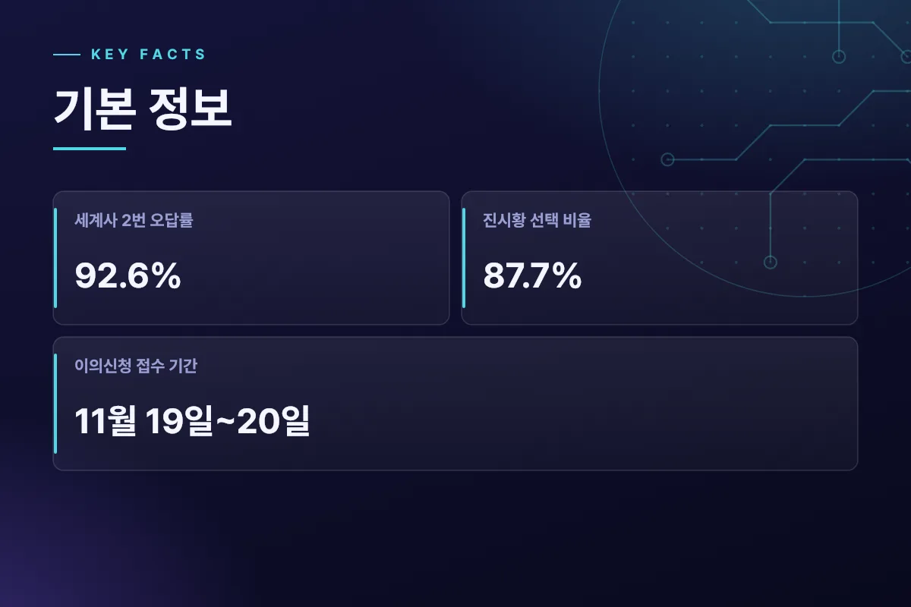
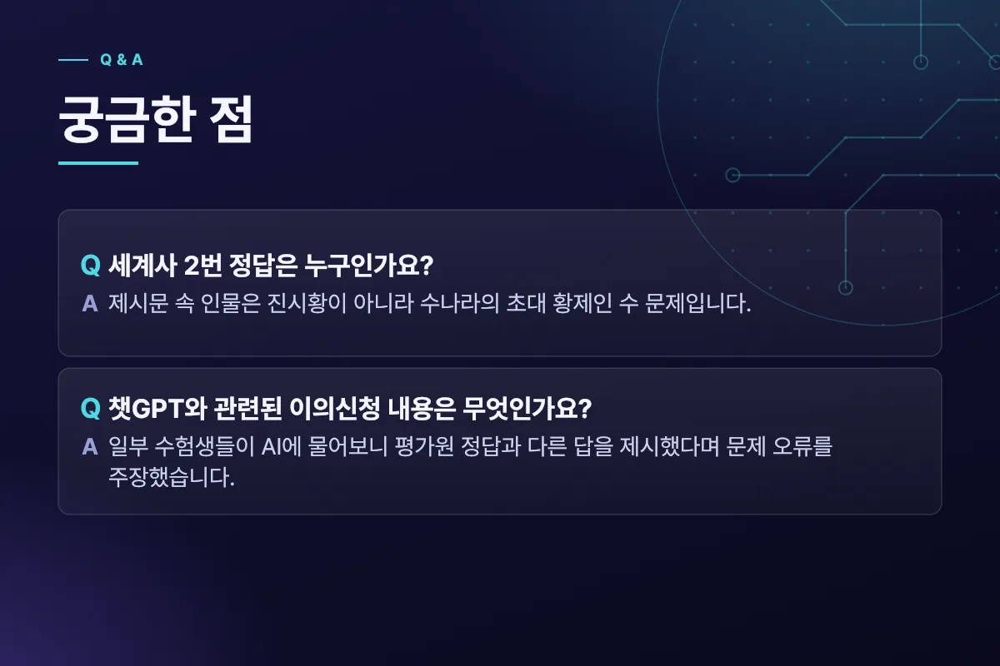
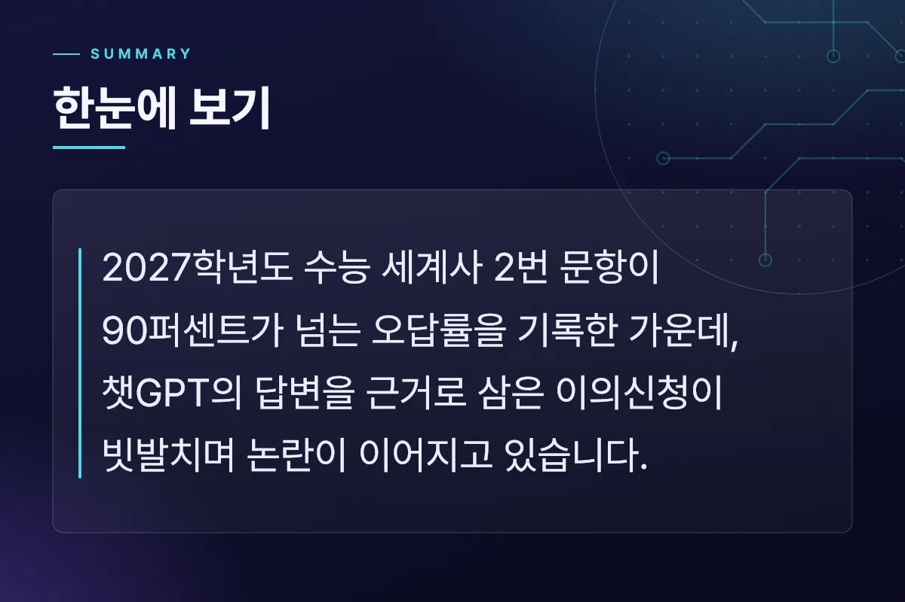

2026년 11월 21일 기준, 지난 19일에 치러진 2027학년도 대학수학능력시험에서 오답률이 90퍼센트를 넘어선 특정 문항을 두고 수험생들의 이의신청이 이어지고 있습니다. 특히 인공지능(AI) 서비스인 챗GPT 등이 실제 정답과 다른 답변을 제시했다는 주장이 제기되면서 온라인상에서 논란이 더욱 커진 상황입니다. 이번 수능에서 어떤 문항이 화제가 되었으며, 챗GPT와 관련된 이의신청 배경은 무엇인지 관련 보도를 바탕으로 자세히 알아봅니다.

<figure>

<figcaption>세계사 2번 문항 관련 주요 지표</figcaption>
</figure>

### 92퍼센트를 넘긴 수능 세계사 2번 문항의 실체와 오답 원인

지난 19일에 치러진 2027학년도 대학수학능력시험 세계사 2번 문항은 중국 황제의 업적을 제시문으로 다룬 오지선다형 문제였습니다. 한국일보 등 주요 언론 보도에 따르면, EBSi 채점 건수를 기준으로 할 때 해당 문항의 오답률은 92.6퍼센트에 달했습니다. 오지선다형 시험이라는 특성상 수험생들이 임의로 번호를 찍더라도 오답률이 80퍼센트에 수렴한다는 점을 감안하면, 이 수치는 매우 이례적으로 높다는 평가를 받습니다.

JTBC와 동아일보 등 보도 내용을 살펴보면, 수험생의 87.7퍼센트는 제시문 속 인물을 진시황으로 골랐던 것으로 나타났습니다. 하지만 실제 제시문 속 인물은 수나라의 초대 황제인 수 문제였던 것으로 확인되었습니다. 문제에서 요구하는 역사적 인물과 수험생들이 떠올린 인물이 서로 엇갈리면서 대다수의 수험생이 오답을 선택하게 된 배경이 되었습니다. 이처럼 높은 난이도와 예상치 못한 출제 포인트가 맞물리면서 시험 직후부터 수험생들 사이에서 당혹스러움이 쏟아져 나왔습니다.

### 챗GPT 오답 제시 주장의 등장과 이의신청 확산 과정

문제의 난이도가 높았던 점과 더불어, 수험생들이 이의신청을 제기하는 과정에서 인공지능 도구를 언급하면서 이번 사태는 새로운 국면을 맞이했습니다. 문화일보와 이데일리 등의 보도에 따르면, 한국교육과정평가원에 접수된 문제 및 정답 이의신청 게시글 중에는 인공지능에 질문을 던졌더니 평가원 정답과 다른 답변을 내놓았다는 내용이 포함되었습니다. 

일부 수험생들은 챗GPT가 실제 정답이 아닌 다른 선택지를 정답으로 지목하거나 유보적인 태도를 보였다고 언급하며, 이를 근거로 평가원이 제시한 정답 자체에 오류가 있다고 주장했습니다. 경향신문 보도에 따르면 온라인에서 화제가 된 이 문항이 올해 수능의 공식적인 킬러문항으로 분류된 것은 아니었음에도 불구하고, AI의 답변 결과와 맞물려 수험생들 사이에서 거센 항의가 이어지고 있는 모습입니다. 시험을 치른 수험생들이 정답 검증 과정에서 기술 도구의 판단을 직접 인용하여 이의를 제기한 드문 사례로 주목받고 있습니다.

<figure>

<figcaption>수능 세계사 문항 및 AI 관련 FAQ</figcaption>
</figure>

### AI 도구 활용에 대한 사회적 시선과 시험 환경의 변화

이번 수능 세계사 문항을 둘러싼 소동은 시험 이후 정답을 검증하고 이의를 제기하는 과정에서 인공지능 도구가 대중적으로 어떻게 개입하고 있는지 보여주는 단면이 되었습니다. 연합뉴스 등 언론 보도에 따르면 최근 대학수학능력시험을 비롯한 각종 국가 자격시험에서 AI 도구의 활용과 부정행위 방지, 그리고 기술적 한계에 대한 논의가 함께 다뤄지고 있습니다. 

대학생들이 국내외 AI 모델들을 대상으로 수능 전 과목을 풀게 한 시험 결과나, 해킹 및 커닝 등 기술적 역습에 대응하기 위한 보안 강화 필요성이 제기되는 흐름 속에서, 이번 세계사 2번 문항의 이의신청 사태는 AI의 답변을 바라보는 대중의 시선과 맞물려 더욱 화제가 되었습니다. 평가원이 향후 접수된 이의신청 건들에 대해 어떤 공식적인 심사 결과를 내놓을지 관심이 집중되는 시점입니다.

<figure>

<figcaption>수능 세계사 문항 논란 핵심 요약</figcaption>
</figure>

### 글을 마무리하며

2027학년도 수능 세계사 2번 문항은 92.6퍼센트라는 높은 오답률을 기록하며 수험생들에게 큰 혼란을 남겼습니다. 이 과정에서 일부 수험생들이 챗GPT 등의 인공지능 도구가 제시한 답변을 근거로 평가원에 이의신청을 제기하면서 논란이 더욱 확산되었습니다. 정확한 채점 결과와 평가원의 최종 이의신청 심사 결과는 공식 채널을 통해 확인해야 하며, 기술 도구의 답변을 무조건적인 근거로 삼는 현상에 대해서는 신중한 접근이 필요합니다.

## 참고한 자료

- [“챗GPT도 틀렸다”…오답률 92% 수능 세계사 2번, 이의신청 빗발](https://www.munhwa.com/article/11632973?ref=naver) — munhwa.com, 2026-11-21 보도
- [AI돋보기 해킹에 커닝까지…AI의 역습에 한국 사회 비상](https://www.yna.co.kr/view/AKR20261119149900017?input=1195m) — 연합뉴스, 2026-11-21 보도
- [단독숨진 LEET 만점자 1, 2교시 시험지 보관 안돼… 3교시 논술형은 안...](https://www.donga.com/news/Society/article/all/20261120/135063859/2) — 동아일보, 2026-11-21 보도
- [오답률 92.6% 세계사 2번 …“AI도 진시황이라는데?” 이의신청](https://www.edaily.co.kr/News/Read?newsId=04346006645647688&mediaCodeNo=257&utm_source=naver&utm_medium=referral&utm_campaign=news_syndication&utm_content=original_article) — 이데일리, 2026-11-20 보도
- [수능 '이의제기' 폭발한 이 문제, 92%가 틀렸다... "챗GPT도 진시황이라...](https://www.hankookilbo.com/news/article/A2026112011030002888?did=NA) — 한국일보, 2026-11-20 보도
- [“챗GPT도 2번이라는데”…수능 세계사 이의 폭주한 ‘이 문항’](https://www.kyeonggi.com/article/20261120580287) — kyeonggi.com, 2026-11-20 보도

2026년 11월 21일 기준으로 정리했습니다. 일정이나 금액처럼 바뀔 수 있는 내용은 위 참고 자료에서 한 번 더 확인해 주세요.
