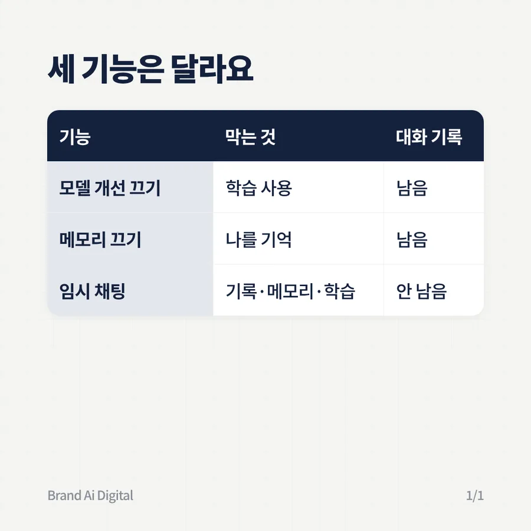
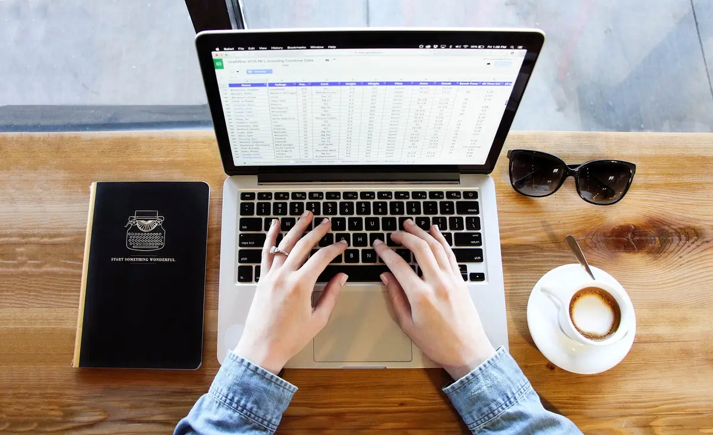

ChatGPT 무료·Plus·Pro 개인 계정은 **대화가 모델 학습에 쓰이는 설정이 기본으로 켜져 있고**, 설정의 데이터 제어(Data controls)에서 "모두를 위한 모델 개선(Improve the model for everyone)"을 끄면 대화 기록은 그대로 둔 채 학습만 끌 수 있습니다. OpenAI 고객센터의 데이터 제어 안내 기준입니다.

## 학습 끄기, 메모리 끄기, 임시 채팅은 다릅니다

세 기능은 막는 대상이 서로 다릅니다. 헷갈리기 쉬워 먼저 표로 나눠 보면 이렇습니다.

| 기능 | 막는 것 | 대화 기록 |
| --- | --- | --- |
| 모델 개선 끄기 | 내 대화가 학습에 쓰이는 것 | 그대로 남음 |
| 메모리 끄기 | ChatGPT가 나를 기억해 답에 쓰는 것 | 그대로 남음 |
| 임시 채팅 | 기록·메모리·학습을 그 대화에서만 모두 | 기록에 안 남음 |

## 대화 학습 끄는 법

OpenAI 고객센터에 따르면 순서는 다음과 같습니다.

- **웹(로그인 상태):** 프로필 메뉴 → 설정(Settings) → 데이터 제어(Data controls) → 모두를 위한 모델 개선(Improve the model for everyone) 끄기
- **휴대폰 앱:** 홈 탭이 보이면 누르고 사이드바를 연 뒤 → 프로필 아이콘 → 설정 → 데이터 제어 → 같은 항목 끄기

로그인 상태에서 바꾼 설정은 웹과 모바일 모든 기기에 함께 적용됩니다. 로그인하지 않고 쓸 때는 설정에서 끄면 그 브라우저에만 저장됩니다. 화면 언어가 한국어라면 메뉴 이름이 우리말로 바뀌어 보일 수 있습니다.

고객센터는 학습을 꺼도 저장된 대화가 지워지거나 숨겨지지 않는다고 설명합니다. 일반 대화는 기록에 그대로 있고, 보관한 대화도 보관 상태로 남습니다. 대화를 보관(Archive)한다고 학습 여부가 바뀌지는 않는다는 점도 함께 안내합니다.

## 예외로 알아 둘 것

음성 모드는 학습 공유 설정이 따로 있다고 고객센터는 설명합니다. 음성으로 자주 쓴다면 음성 쪽 설정도 확인해야 합니다.

ChatGPT Business, Enterprise, Edu 같은 회사·학교 워크스페이스는 기본적으로 내용이 학습에 쓰이지 않는다고 OpenAI는 밝힙니다. 이 글에서 권하는 판단 기준은 **회사 자료를 다룬다면 개인 계정의 설정을 바꾸기보다 회사 계정을 쓰는 것**입니다. 다른 AI 서비스도 비슷한 구조라, 예를 들어 [NotebookLM 무료 한도](/p/gemini-notebook-notebooklm-limits/) 글에서 다룬 것처럼 회사 계정과 개인 계정의 데이터 처리가 다릅니다.

## 메모리 끄는 법과 확인하는 법

메모리는 학습과 별개입니다. OpenAI 고객센터에 따르면 메모리를 켜면 ChatGPT가 지난 대화, 저장된 메모리, 맞춤형 지침 등에서 관련 있는 내용을 기억해 답에 활용합니다.

메모리 설정은 설정(Settings) → 개인 맞춤(Personalization) → 메모리(Memory)에서 바꿀 수 있습니다. 요금제와 지역에 따라 보이는 항목이 다를 수 있다고 고객센터는 덧붙였습니다.

메모리를 꺼도 지난 대화는 지워지지 않습니다. 나중에 다시 켜면 기록에 남아 있는 대화에서 새로 기억을 만들 수 있다는 점도 고객센터가 짚은 부분입니다. ChatGPT가 무엇을 기억하는지는 메모리 요약 화면이나 "나에 대해 뭘 기억해?"라고 직접 물어 확인할 수 있습니다.

## 임시 채팅은 언제 쓰나

임시 채팅은 한 번만 쓰고 남기고 싶지 않은 대화에 맞습니다. 고객센터에 따르면 임시 채팅으로 남아 있는 동안 그 대화는 다음과 같습니다.

- 대화 기록에 나타나지 않습니다.
- 메모리를 만들거나 바꾸지 않습니다.
- OpenAI 모델 개선에 쓰이지 않습니다.
- 안전 목적상 최대 30일 동안 보관될 수 있습니다.

임시 채팅을 저장하면 일반 대화가 되어 내 계정의 개인 맞춤·모델 개선 설정을 따릅니다. 시작할 때 기존 메모리와 맞춤 지침을 쓸지 고를 수 있다는 점도 안내돼 있습니다.

## 자주 묻는 질문

**ChatGPT 무료 사용자도 학습을 끌 수 있나요?**

네. 고객센터에 따르면 개인 워크스페이스의 무료·Plus·Pro 모두 데이터 제어에서 모델 개선을 끌 수 있습니다.

**학습을 끄면 대화 기록이 없어지나요?**

아닙니다. 학습을 꺼도 저장된 대화는 지워지거나 숨겨지지 않습니다.

**임시 채팅 내용은 완전히 지워지나요?**

기록에는 남지 않지만 안전 목적상 최대 30일 동안 보관될 수 있다고 OpenAI는 안내합니다.

**메모리를 끄면 학습도 꺼지나요?**

아닙니다. 메모리는 나를 기억해 답에 쓰는 기능이고, 학습 여부는 데이터 제어의 모델 개선 설정이 따로 정합니다.

**대화를 보관하면 학습에서 빠지나요?**

아닙니다. 고객센터는 보관이 학습 여부를 바꾸지 않으며 모델 개선 설정이 계속 적용된다고 설명합니다.

## 핵심 요약

- OpenAI 고객센터에 따르면 ChatGPT 무료·Plus·Pro 개인 계정은 대화 학습 공유가 기본으로 켜져 있고, 설정 → 데이터 제어에서 "모두를 위한 모델 개선"을 끄면 기록은 남긴 채 학습만 끌 수 있습니다.
- ChatGPT 메모리는 학습과 별개의 기능으로, 설정 → 개인 맞춤 → 메모리에서 끄더라도 지난 대화는 지워지지 않습니다.
- ChatGPT 임시 채팅은 기록에 남지 않고 메모리와 모델 개선에 쓰이지 않지만, 안전 목적상 최대 30일 동안 보관될 수 있습니다.

## 참고한 자료

- [Data controls in ChatGPT](https://help.openai.com/en/articles/7730893-data-controls-faq) — OpenAI 고객센터, 확인일 2026-11-28
- [Memory in ChatGPT](https://help.openai.com/en/articles/8590148-memory-faq) — OpenAI 고객센터, 확인일 2026-11-28
- 사진 일부: Pixabay (무료 이용 허가 이미지)

정보 기준일: 2026-11-28. ChatGPT 메뉴 이름과 설정은 자주 바뀌니 앱의 최신 화면을 함께 확인하세요.
