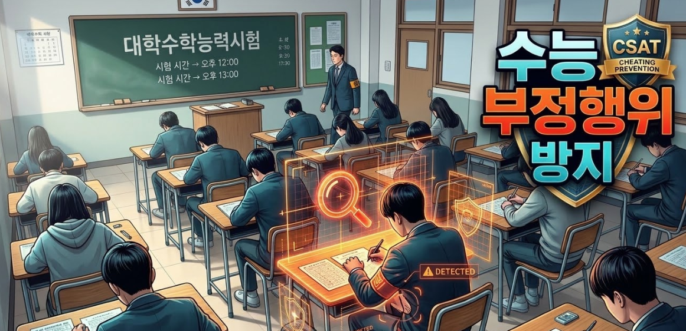
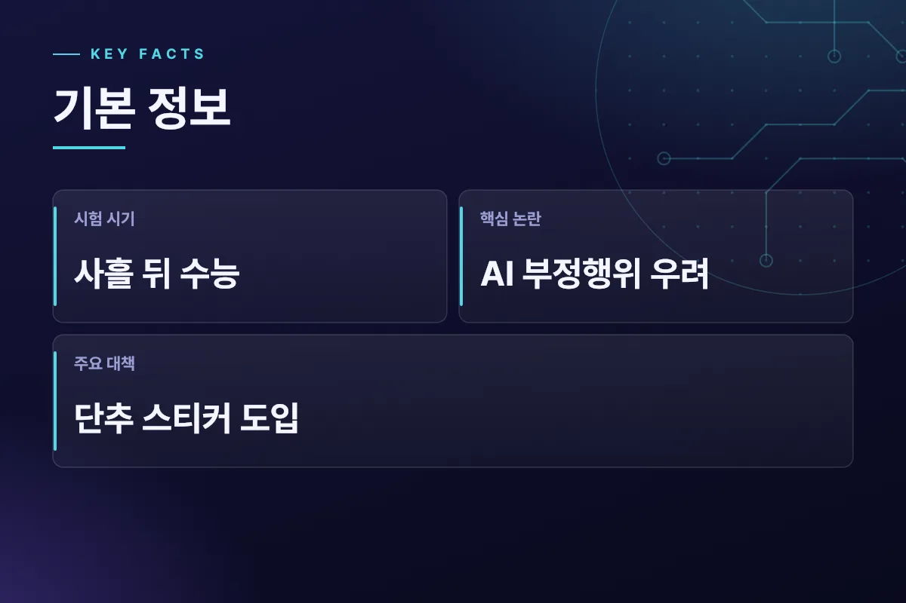
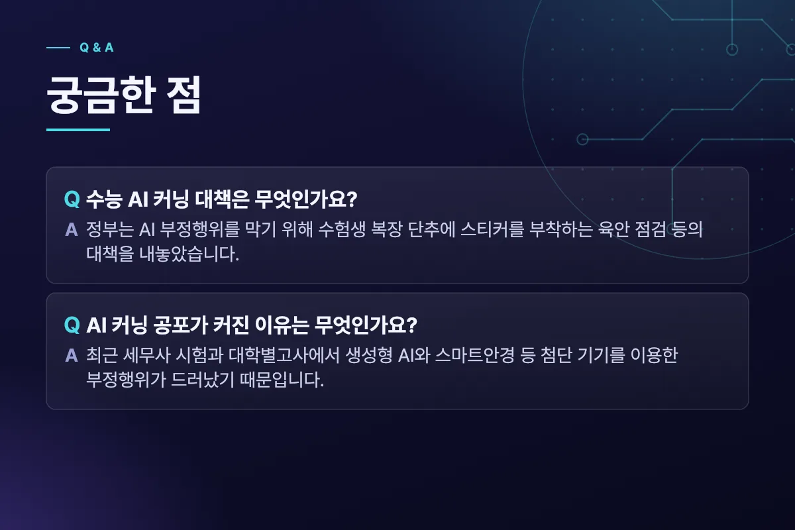
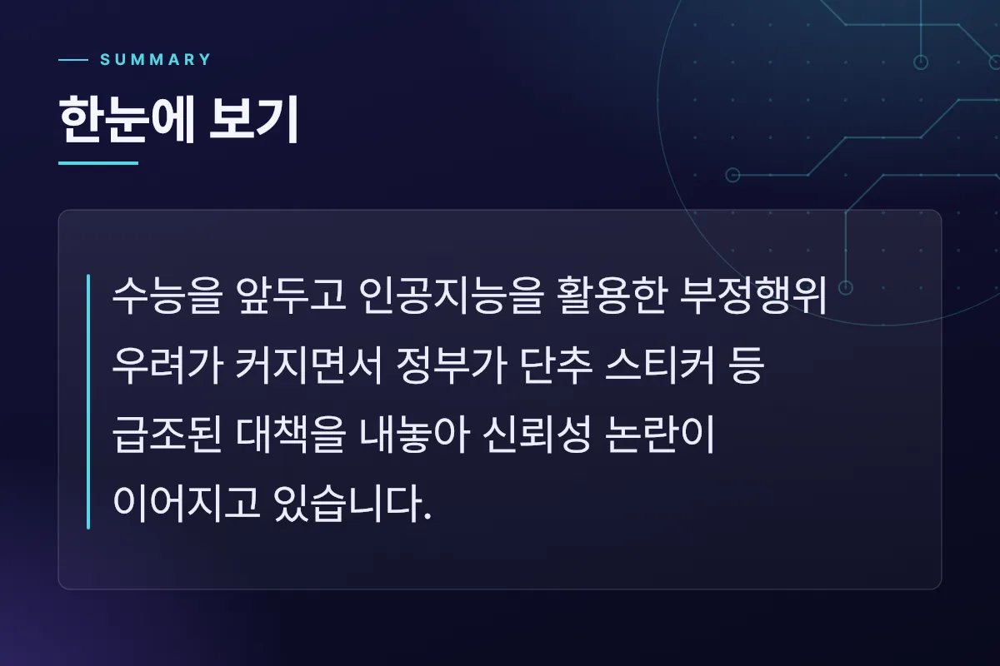

2026년 11월 18일 기준으로 수능 시험을 목전에 둔 시점에서 인공지능(AI)을 활용한 부정행위 우려가 커지며 시험 관리 당국의 대책과 현장의 반응이 주목받고 있습니다. 서울경제 등 주요 언론 보도에 따르면, 최근 세무사 시험과 대학별고사 등에서 생성형 AI와 첨단 전자기기를 이용한 부정행위가 잇따라 드러난 뒤 수능 시험을 앞두고 유사한 방식의 커닝 공포가 확산되는 중입니다. 시험 관리 당국은 감독 강화와 함께 의복 점검 등 급한 불을 끄기 위한 조치를 내놓았으나, 현장에서는 대책이 미흡하다는 지적과 함께 신뢰성에 대한 의문이 제기되고 있습니다.

<figure>

<figcaption>수능 시험장 전경과 부정행위 방지 대책을 상징하는 일러스트 화면</figcaption>
</figure>

## 터져 나온 AI 부정행위 우려와 시험장 풍경

2026년 11월 18일 연합뉴스 및 서울경제 보도를 종합하면, 올해 수능을 앞두고 가장 큰 변수로 떠오른 것은 단연 첨단 기술을 동원한 부정행위 우려입니다. 과거의 부정행위가 전통적인 방식을 벗어나지 않았다면, 최근에는 인공지능 기능이 탑재된 스마트안경이나 초소형 카메라, 단추 형태의 전자기기 등이 거론되며 수험생과 학부모들의 불안감을 키우고 있습니다. 세무사 시험 등에서 이미 유사한 사건이 발생한 직후라 수능 관리 당국을 향한 시선은 더욱 엄격해진 상태입니다.

이와 관련해 KBS는 수능 예비 소집 현장과 주의사항을 전하며, 수험생들이 시험장 위치와 선택과목을 꼼꼼하게 확인하는 동시에 강화된 통제 속에서 시험을 준비하고 있다고 보도했습니다. 하지만 시험을 불과 사흘 앞둔 시점에서 불거진 논란은 수험생과 학부모들에게 큰 심리적 부담으로 작용하고 있습니다. 교육 현장에서는 이러한 위험이 이미 예고되어 있었음에도 불구하고 사후약방문식 대응에 그치고 있다는 비판 목소리가 터져 나오는 상황입니다.

<figure>

<figcaption>수능 AI 커닝 방지 핵심 항목 비교 카드</figcaption>
</figure>

## 정부의 육안 점검 대책과 쏟아지는 현장 비판

서울신문은 정부가 인공지능을 활용한 부정행위를 막기 위해 내놓은 대책 중 하나로 수험생 옷 단추마다 스티커를 부착하는 방안 등이 거론되면서 현장의 실효성 논란이 가중되고 있다고 보도했습니다. 시험을 코앞에 둔 시점에 급조된 대책들이 나오다 보니, 교사와 수험생들 사이에서는 수능 금지 복장까지 등장하는 등 혼선이 빚어지고 있습니다. 

서울경제 사설에서는 이러한 늑장 대책이 오히려 수능의 신뢰도를 떨어뜨린다고 강하게 지적했습니다. AI 부정행위 문제는 어제오늘 제기된 것이 아님에도 불구하고, 최근 세무사 시험 사건이 터진 뒤에야 급하게 대책을 마련하다 보니 현장 상황과 괴리가 발생했다는 분석입니다. 기술은 날로 발전하고 부정행위 수법 또한 정교해지는 반면, 당국의 대응은 여전히 육안 점검이나 스티커 부착 수준에 머물러 있다는 비판이 이어지고 있습니다.

<figure>

<figcaption>수능 AI 부정행위 방지 대책 FAQ 카드</figcaption>
</figure>

## 입시 공정성과 수험생들이 마주한 현실

오마이뉴스 등의 보도에 따르면, 수능을 사흘 앞둔 수험생들과 학부모들은 흔들리는 공정성 속에서 깊은 씁쓸함을 드러내고 있습니다. 정직하게 시험을 준비해 온 수험생들이 상대적으로 박탈감을 느끼거나, 기회의 사다리로 불리는 대입 제도의 신뢰가 흔들리는 상황에 대한 우려가 커지고 있습니다. 1020세대는 코앞으로 다가온 수능 외에도 다양한 사회적 이슈와 맞물려 공정성에 대한 고민을 깊게 안고 있는 모습입니다.

이데일리 등 매체는 세대별 주요 화두를 다루며 수능을 앞둔 1020세대의 불안정한 현실을 조명했습니다. 교육부 장관의 경질을 요구하는 목소리가 4th.kr 등을 통해 보도되는 등, 이번 AI 커닝 논란은 단순한 시험 관리를 넘어 입시 제도 전반의 책임 공방으로 번지는 모양새입니다. 시험 관리 당국이 남은 기간 동안 어떤 추가적인 보완책을 내놓을지, 그리고 실제 시험장에서 얼마나 실효성을 거둘지는 아직 [확인 필요] 상태로 남아 있습니다.

<figure>

<figcaption>수능 AI 커닝 공포 및 대책 요약 카드</figcaption>
</figure>

## 자주 묻는 질문

**Q. 수능 AI 커닝을 막기 위해 정부가 내놓은 대책은 무엇인가요?**

A. 정부는 인공지능과 첨단 전자기기를 이용한 부정행위를 차단하기 위해 감독을 강화하고 수험생 복장 단추에 스티커를 부착하는 등의 현장 점검 대책을 내놓았습니다. 다만 이러한 조치들이 급조된 탓에 실효성과 신뢰성을 두고 현장에서 다양한 비판이 제기되고 있습니다.

**Q. AI 부정행위 논란이 갑자기 커진 이유는 무엇인가요?**

A. 최근 세무사 시험과 대학별고사 등에서 생성형 AI와 스마트안경, 초소형 카메라 등을 악용한 부정행위가 잇따라 드러났기 때문입니다. 사흘 뒤 수능을 앞두고 유사한 수법이 동원될 수 있다는 공포가 확산되면서 사회적 관심이 집중되었습니다.

**Q. 현장과 언론에서 지적하는 대책의 한계는 무엇인가요?**

A. 기술과 부정행위 수법은 빠르게 진화하고 있으나, 당국의 대책은 여전히 육안 점검이나 단추 스티커 부착 등 기초적인 수준에 머물러 있다는 지적을 받고 있습니다. 사전에 충분한 검토 없이 늑장 대응으로 일관했다는 비판이 이어지고 있습니다.

**Q. 수험생들과 학부모들의 반응은 어떠한가요?**

A. 시험을 코앞에 두고 불거진 AI 커닝 논란으로 인해 기회의 사다리인 대입 수능의 공정성이 흔들리고 있다는 우려가 커지고 있습니다. 정직하게 시험을 준비해 온 수험생들이 박탈감을 느끼며 제도의 신뢰 회복을 요구하는 목소리가 높습니다.

**Q. 향후 시험 관리 당국의 추가 대책은 확정되었나요?**

A. 추가적인 보완 대책이나 현장 적용의 세부 결과는 보도 시점 기준으로 아직 구체적으로 확인되지 않았으며, 실제 시험장에서의 엄격한 관리 감독 이행 여부가 주목되는 상황입니다.

## 참고한 자료

- [재수생 23년 만에 최대, AI 커닝까지 “08년생에게 왜 그러냐”…‘최악...](https://www.sedaily.com/article/20115706?ref=naver) — 서울경제, 2026-11-18 보도
- [AI 시대 대입 수능, 여전히 유효할까?](https://www.ohmynews.com/NWS_Web/View/at_pg.aspx?CNTN_CD=A0003286067&CMPT_CD=P0010&utm_source=naver&utm_medium=newsearch&utm_campaign=naver_news) — ohmynews.com, 2026-11-18 보도
- [전국 주요 신문 톱뉴스(18일 조간)](https://www.yna.co.kr/view/AKR20261118020800011?input=1195m) — 연합뉴스, 2026-11-18 보도
- [사설 수능 ‘AI 커닝’ 대책이 육안 점검과 스티커 붙이기라니](https://www.sedaily.com/article/20115611?ref=naver) — 서울경제, 2026-11-18 보도
- [수능 AI 커닝 공포 키운 교육부 장관, 즉각 경질해야](http://www.4th.kr/news/articleView.html?idxno=2122168) — 4th.kr, 2026-11-18 보도
- [기자수첩두 번 흔들린 '기회의 사다리'…수능일에는 빈틈없길](https://www.newsis.com/view/NISX20261118_0003872476) — 뉴시스, 2026-11-18 보도

2026년 11월 18일 기준으로 정리했습니다. 일정이나 금액처럼 바뀔 수 있는 내용은 위 참고 자료에서 한 번 더 확인해 주세요.
