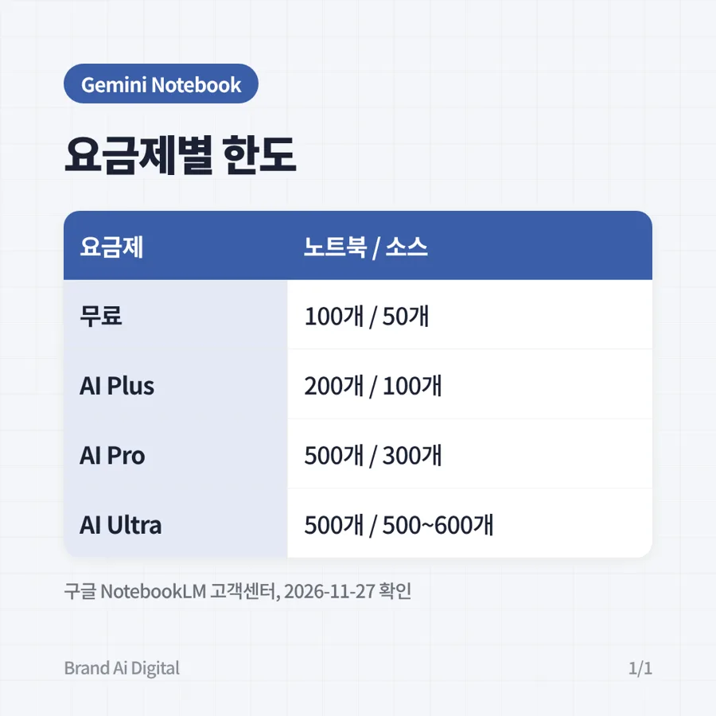

Gemini Notebook(이전 이름 NotebookLM)은 **무료로 노트북 100개, 노트북당 소스 50개**까지 쓸 수 있습니다. 구글 AI 요금제에 가입하면 한도가 늘어나 AI 플러스는 노트북 200개·소스 100개, AI 프로는 노트북 500개·소스 300개가 됩니다. 구글 NotebookLM 고객센터의 요금제 안내 페이지 기준이며, 구글은 이 한도가 바뀔 수 있다고 밝히고 있습니다.

## 요금제별 한도 비교

| 요금제 | 노트북 수 | 노트북당 소스(메모 제외) |
| --- | --- | --- |
| 무료 | 사용자당 100개 | 50개 |
| Google AI Plus | 사용자당 200개 | 100개 |
| Google AI Pro | 사용자당 500개 | 300개 |
| Google AI Ultra(20TB) | 사용자당 500개 | 500개 |
| Google AI Ultra(30TB) | 사용자당 500개 | 600개 |

메모로 만든 소스는 별도 한도가 있습니다. 구글 고객센터에 따르면 메모 소스는 무료·플러스·프로가 노트북당 500개, 울트라는 600개입니다.

## 무료로 쓸 수 있는 것

구글 고객센터에 따르면 Gemini Notebook은 지원 국가에서 동의 연령 이상이면 누구나 Gmail 계정으로 무료로 가입해 브라우저에서 쓸 수 있습니다. 맞춤 채팅과 분석 기능은 모든 사용자가 쓸 수 있고, 고급 공유는 유료 사용자만 쓸 수 있습니다.

일상적으로 자료 몇 개를 넣어 요약하거나 질문하는 용도라면 노트북 100개, 소스 50개로 충분한 경우가 많습니다. 한 노트북에 논문이나 회의록을 수십 개씩 넣어 분석해야 할 때 한도가 먼저 문제가 됩니다.

## 유료로 바꾸면 달라지는 것

구글 고객센터 표에 따르면 요금제가 올라갈수록 다음이 달라집니다.

- **Gemini 모델 접근:** 무료·플러스는 "Gemini 모델 접근", 프로는 "더 높은 수준", 울트라는 "최고 수준"으로 표시됩니다.
- **새 기능 먼저 써 보기:** 무료는 일반, 플러스는 조기, 프로와 울트라는 최우선입니다.
- **워터마크:** 눈에 보이는 워터마크 제거는 프로와 울트라에서 가능하다고 표시돼 있지만, **대한민국, 베트남, 인도에 거주하면 눈에 보이는 워터마크가 자동으로 적용**된다는 단서가 붙어 있습니다. 한국 사용자는 유료여도 워터마크가 남을 수 있다는 뜻입니다.

Gemini 구독 페이지에는 AI 프로의 Gemini Notebook이 AI 음성 개요(오디오 오버뷰)를 5배 더 많이 이용할 수 있다고 적혀 있습니다. 구글 AI 요금제 전체 가격은 [제미나이 무료·유료 차이](/p/google-ai-plans-gemini-free-plus-pro/)에서 정리했습니다.

## 할당량은 언제 다시 채워지나

구글 고객센터에 따르면 일일 할당량은 24시간 뒤에, 월간 할당량은 30일 뒤에 재설정됩니다. 노트북을 다른 사람과 공유해도 공동작업자의 한도는 바뀌지 않습니다.

처음 소스를 추가할 때 보고서, 플래시카드, 인포그래픽, 슬라이드, AI 오디오 오버뷰, AI 동영상 오버뷰가 자동으로 한 번 만들어질 수 있는데, 이 자동 생성분은 한도에 포함되지 않는다고 안내돼 있습니다.

## 내 자료는 학습에 쓰이나

구글 고객센터는 Gemini Notebook의 데이터가 보호되며, 사용자가 의견(좋아요·싫어요 등)을 제공하지 않는 한 학습에 쓰이지 않는다고 설명합니다. 의견을 보내면 그 상호작용의 질문, 업로드 내용, 답변 전체를 구글이 검토할 수 있습니다.

회사나 학교 계정(Google Workspace, Workspace for Education)으로 쓰는 경우는 다릅니다. 이때는 업로드, 질문, 답변이 의견을 보내더라도 사람이 검토하지 않고 AI 모델 학습에도 쓰이지 않는다고 안내돼 있습니다. **업무 자료를 넣을 때는 개인 계정보다 회사 계정으로 쓰는 편이 안전**하다는 것이 이 글의 판단입니다.

## 상황별로 고르는 기준

1. **가끔 자료를 요약한다:** 무료로 충분합니다.
2. **한 주제에 자료가 50개를 넘는다:** AI 플러스로 소스 100개까지 늘리는 것이 가장 저렴한 해결책입니다.
3. **연구·업무로 자료가 수백 개다:** AI 프로부터 노트북당 300개를 넣을 수 있습니다.
4. **회사 기밀 자료를 다룬다:** 요금제보다 계정 종류가 중요합니다. 회사 Workspace 계정 사용을 먼저 확인하세요.

## 자주 묻는 질문

**NotebookLM과 Gemini Notebook은 같은 서비스인가요?**

구글 NotebookLM 고객센터가 현재 이 서비스를 Gemini Notebook이라는 이름으로 안내하고 있습니다. 고객센터 이름과 주소는 NotebookLM 그대로입니다.

**NotebookLM 무료 버전은 소스를 몇 개까지 넣을 수 있나요?**

노트북당 50개입니다(메모 제외). 노트북은 사용자당 100개까지 만들 수 있습니다.

**유료로 바꾸면 워터마크가 없어지나요?**

프로와 울트라는 워터마크 제거가 가능하다고 표시되지만, 대한민국 거주자는 눈에 보이는 워터마크가 자동으로 적용된다고 안내돼 있습니다.

**할당량을 다 쓰면 언제 다시 쓸 수 있나요?**

일일 할당량은 24시간 뒤, 월간 할당량은 30일 뒤에 재설정됩니다.

**업로드한 자료가 AI 학습에 쓰이나요?**

의견을 보내지 않으면 학습에 쓰이지 않는다고 구글은 설명합니다. 회사·학교 Workspace 계정은 의견을 보내도 학습과 사람 검토에 쓰이지 않습니다.

**노트북을 공유하면 상대방 한도도 늘어나나요?**

아닙니다. 노트북을 공유해도 공동작업자의 한도는 바뀌지 않습니다.

## 핵심 요약

- 구글 NotebookLM 고객센터에 따르면 Gemini Notebook 무료 사용자는 노트북 100개, 노트북당 소스 50개(메모 제외)까지 쓸 수 있습니다.
- Gemini Notebook 노트북당 소스 한도는 Google AI Plus 100개, Google AI Pro 300개, Google AI Ultra 500~600개로 요금제에 따라 늘어납니다.
- 구글 고객센터는 대한민국 거주자의 경우 Gemini Notebook 결과물에 눈에 보이는 워터마크가 자동으로 적용된다고 안내합니다.

## 참고한 자료

- [Gemini Notebook 요금제 알아보기](https://support.google.com/notebooklm/answer/16213268?hl=ko) — Google NotebookLM 고객센터, 확인일 2026-11-27
- [Gemini 구독 요금제](https://gemini.google/kr/subscriptions/) — Google, 확인일 2026-11-27
- 사진 일부: Pixabay (무료 이용 허가 이미지)

정보 기준일: 2026-11-27. 구글은 사용량 한도가 바뀔 수 있다고 밝히고 있으니 가입 전에 고객센터 페이지를 다시 확인하세요.
