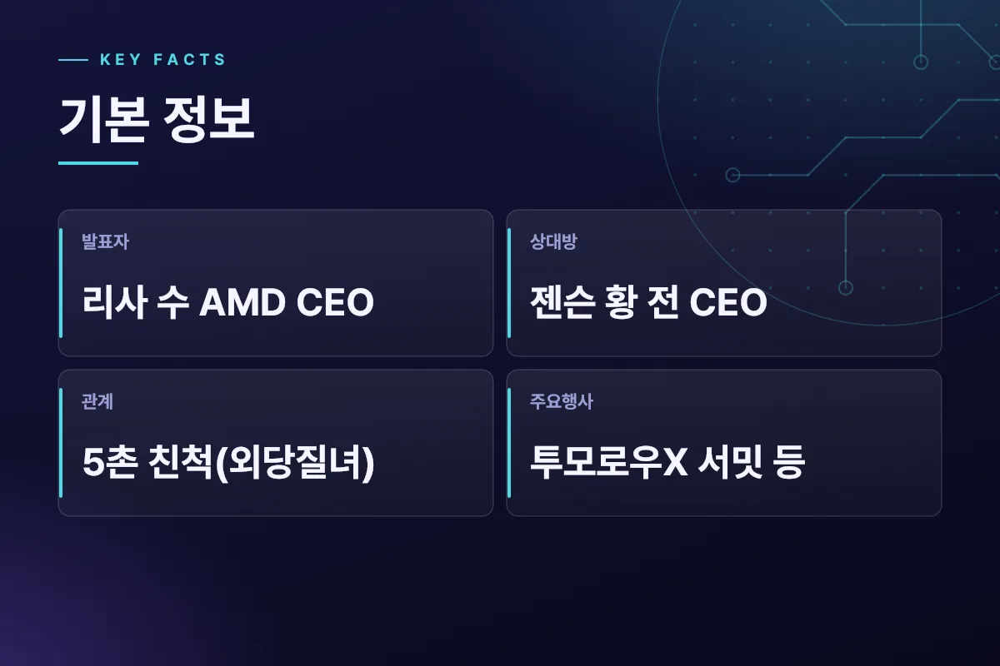
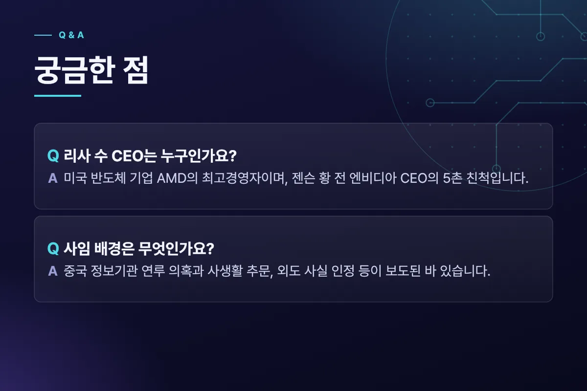
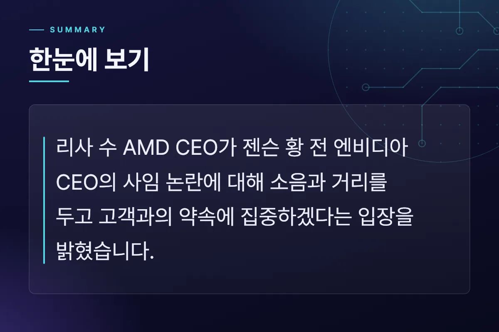

2026년 11월 20일 기준, 최근 불거진 젠슨 황 전 엔비디아 최고경영자(CEO)의 사임 논란과 관련해 그의 5촌 친척이자 경쟁사인 AMD를 이끄는 리사 수 CEO가 처음으로 공식 입장을 밝혔습니다. 리사 수 CEO는 최근 일련의 혼란스러운 상황 속에서도 주변의 소음과 거리를 두고 자사의 사업과 고객과의 약속을 이행하는 데 집중하겠다는 뜻을 명확히 했습니다. 

글로벌 반도체 시장을 이끌어온 두 거물의 관계와 경쟁 구도를 아는 이들에게 이번 사태는 큰 파장을 불러일으켰으며, 경쟁사의 수장이 직접 내놓은 발언에 업계의 이목이 집중되고 있습니다.

<figure>

<figcaption>리사 수 CEO의 입장 발표와 관련된 주요 정보</figcaption>
</figure>

## 엔비디아 수장 교체를 둘러싼 업계의 혼란과 시선

엔비디아를 이끌어온 젠슨 황 전 CEO가 자리에서 물러난 이후, 글로벌 반도체 업계는 전례 없는 혼란에 휩싸였습니다. 조선일보와 데일리안 등 여러 매체의 보도에 따르면, 젠슨 황 전 CEO는 사임 직전 외도 사실을 전 직원에게 인정하고 사과했으며, 이와 함께 중국 정보기관 연루 의혹과 사생활 추문 등이 불거진 상태입니다. 사임 이후 조건부로 복귀할 뜻이 있다는 관측도 일부 제기되고 있으나, 빅테크 업계와 시장의 반응은 극단적으로 엇갈리고 있습니다.

아시아경제 등 보도에 따르면 회사를 이끌어온 창업자의 갑작스러운 퇴진을 두고 "조던 내쫓는 격"이라며 우려를 표하는 목소리가 존재하는 반면, 다른 한편에서는 "창업자는 신이 아니다"라며 경영진 교체가 불가피했다는 냉정한 평가도 공존합니다. 이러한 다각도의 해석과 논란이 이어지는 가운데, 최대 라이벌 기업의 최고경영자로서 리사 수 CEO가 어떤 시각을 가지고 있는지에 대한 궁금증이 커졌습니다.

<figure>

<figcaption>리사 수 CEO의 입장과 두 사람의 관계에 대한 FAQ</figcaption>
</figure>

## 경쟁사의 수장이 전한 평가와 소음에 대한 태도

경쟁 기업의 최고경영자 자리가 공석이 되고 각종 추문이 이어지는 와중에도, 리사 수 CEO는 지난 16일 '투모로우X 서밋' 등의 자리에서 젠슨 황 전 CEO를 향해 "탁월한 리더"이자 "엄청난 리더"라고 평가했습니다. 뉴시스와 동아일보 등의 보도에 따르면, 수 CEO는 엔비디아가 기본적으로 훌륭한 회사라는 점을 인정하면서도, 그를 둘러싼 스캔들과 경영 혼란에 대해서는 "주변의 소음과 거리를 두어야 한다"고 강조했습니다.

대만계 미국인인 두 사람은 혈연 관계로 얽혀 있어 5촌 친척 사이이며, 수 CEO가 황 전 CEO의 외당질녀에 해당합니다. 혈연적 유대감을 가지고 있으면서도 동시에 글로벌 반도체 패권을 다투는 라이벌이라는 점에서 두 사람의 관계는 언제나 업계의 비상한 관심을 받아왔습니다. 이번 사태에 대해 수 CEO는 시간이 지나면 관련 소란이 자연스럽게 가라앉을 것이라고 내다보며, AMD 자체의 로드맵과 고객과의 약속을 이행하는 데 전념하겠다는 태도를 고수했습니다.

<figure>

<figcaption>리사 수 CEO가 전한 입장과 향후 전망 요약</figcaption>
</figure>

## 향후 시장 판도에 미칠 영향과 남은 과제

경영진 교체와 연이은 스캔들이 엔비디아 및 전체 반도체 경쟁 구도에 구체적으로 어떤 영향을 미칠지에 대해, 리사 수 CEO는 신중한 태도를 취하며 말을 아꼈습니다. 데일리안과 dkilbo 등의 보도에 따르면, 수 CEO는 불명예 사임 파문에 크게 휘둘리지 않고 자사의 기술 발전과 시장 공략에 주력하겠다는 입장을 거듭 밝혔습니다.

이번 사태가 단기적인 글로벌 시장 판도에 실질적인 변화를 가져올지, 그리고 엔비디아가 새로운 리더십 체제를 구축하여 안정을 찾을 것인지는 아직 명확하게 확정 지을 수 없습니다. 다만 업계에서는 리사 수 CEO의 언급처럼 주변의 소음이 점차 가라앉고 시장의 초점이 다시 본질적인 기술력과 제품 경쟁력으로 이동할지 주목하고 있습니다.

## 참고한 자료

- [리사 수 AMD CEO, '오촌당숙' 젠슨 황 스캔들에 "소음 가라앉을 것"](http://www.inews24.com/view/2028599) — inews24.com, 2026-11-20 보도
- [리사 수 AMD CEO, 친척 젠슨 황 사임에 "주변 소음과 거리 둬야"](https://www.hankookilbo.com/news/article/A2026112008140001719?did=NA) — 한국일보, 2026-11-20 보도
- [엔비디아 경쟁사 AMD의 리사 수, “젠슨 황은 엄청난 리더… 소음은 가...](https://www.chosun.com/economy/tech_it/2026/11/20/MJUDZFRMGZHZJNROQGCEGDWQ64/?utm_source=naver&utm_medium=referral&utm_campaign=naver-news) — 조선일보, 2026-11-20 보도
- [리사 수, ‘5촌’ 젠슨 황 스캔들에 “소음, 가라앉을 것”](https://www.munhwa.com/article/11632762?ref=naver) — munhwa.com, 2026-11-20 보도
- [젠슨 황 경쟁자 리사 수 “그는 탁월한 리더…소음 가라앉을 것”](https://www.donga.com/news/Inter/article/all/20261120/135058182/1) — 동아일보, 2026-11-20 보도
- [리사 수 AMD CEO, 친척 젠슨 황 사임에 "소음과 거리 둬야"](https://www.newsis.com/view/NISX20261120_0003875949) — 뉴시스, 2026-11-20 보도

2026년 11월 20일 기준으로 정리했습니다. 일정이나 금액처럼 바뀔 수 있는 내용은 위 참고 자료에서 한 번 더 확인해 주세요.
