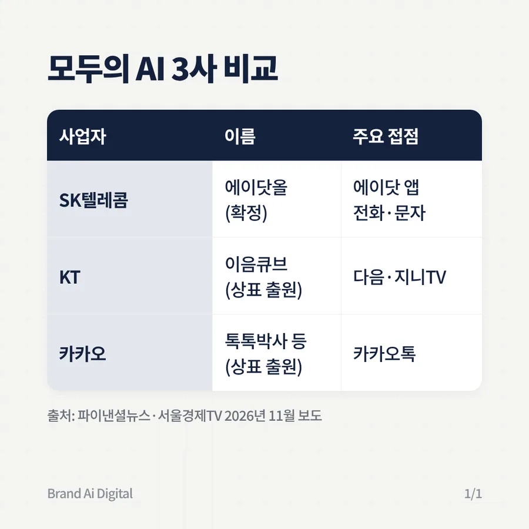

정부의 대국민 AI 서비스 **'모두의 AI'는 12월 정식 출시를 앞두고 있고, 범용 AI 챗봇과 공공 AI 에이전트의 기본 기능은 무료로 제공됩니다.** 파이낸셜뉴스는 2026년 11월 26일 출시 예정일을 12월 15일로 보도했으며, 사업자는 SK텔레콤·KT·카카오 3개 컨소시엄입니다.

## 모두의 AI는 어떤 서비스인가

모두의 AI는 과학기술정보통신부가 추진하는 전 국민 대상 AI 서비스입니다. 경향신문 2026년 8월 28일 보도에 따르면 과기정통부는 서면 평가와 발표 평가를 거쳐 SK텔레콤·카카오·KT 컨소시엄을 사업자로 선정했고, 세 사업자에 엔비디아 B200 GPU 총 512장을 지원합니다. 같은 보도는 내년부터 전 국민 서비스 제공에 필요한 비용도 정부 예산으로 지원할 계획이라고 전했습니다.

뉴데일리 2026년 11월 27일 보도는 모두의 AI가 독자 AI 파운데이션 모델 사업으로 확보한 AI 모델을 국민 누구나 비용 부담이나 이용량 제한 없이 쓰도록 하는 공공 AI 서비스를 표방한다고 설명했습니다.

## 무료 범위: 기본은 무료, 고급 기능은 유료 가능

무료와 유료의 경계는 7월 사업설명회에서 정해졌습니다. 이투데이 2026년 7월 21일 보도에 따르면 과기정통부는 범용 챗봇과 공공 AI 에이전트의 기본 기능은 국민에게 무료로 제공하되, 기업이 특화 서비스나 고도화 기능을 추가해 유료로 운영하는 것은 허용한다는 방침을 밝혔습니다.

정리하면 **일상적인 질문·답변용 챗봇은 무료**, 사업자가 따로 만드는 고급 기능은 **유료일 수 있습니다.** 어떤 기능이 유료가 될지는 사업자별 출시 안내가 나와야 알 수 있습니다.

## SKT·KT·카카오, 무엇이 다른가

세 사업자는 각자 가진 고객 접점에 AI를 붙이는 전략입니다. 파이낸셜뉴스 11월 26일 보도와 서울경제TV 11월 24일 보도를 바탕으로 정리하면 다음과 같습니다.

| 사업자 | 서비스 이름 | 주요 접점과 계획 |
| --- | --- | --- |
| SK텔레콤 | 에이닷올(확정) | 기존 앱 '에이닷' 개편, 전화·문자로도 이용 |
| KT | 이음큐브(상표 출원) | 포털 다음, 지니TV, 다나와·무신사·직방 연계 |
| 카카오 | 톡톡박사·닥터톡톡(상표 출원) | 카카오톡 대화창, LG유플러스·LG전자 협력 |

**SK텔레콤**은 서비스명을 '에이닷올'로 확정했습니다. 파이낸셜뉴스에 따르면 별도 앱 설치 없이 지정 번호로 전화를 걸거나 문자를 보내면 AI가 응대하는 방식을 준비하고, 정부24·본인인증 서비스 '패스'와 연계해 증명서 83종을 발급받는 기능과 AI가 매장·관공서에 대신 전화해 정보를 확인하는 기능도 개발합니다.

**KT**는 '이음 인사이드' 전략으로 앱과 웹뿐 아니라 포털 다음, IPTV 지니TV까지 이용 경로를 넓힙니다. 다나와, 무신사, 직방과 연계해 상품 비교부터 패션·부동산 정보 탐색까지 한 대화창에서 처리하는 것이 목표입니다.

**카카오**는 카카오톡 대화창에서 정보 검색부터 공공서비스 신청, 쇼핑, 예약, 결제까지 처리하는 것을 목표로 합니다. LG유플러스, LG전자 등과 협력해 전화와 가전제품으로도 접점을 넓힐 계획입니다.

## 확정된 것과 아직 정해지지 않은 것

이슈 초기라 바뀔 수 있는 부분이 많습니다. 2026년 11월 28일까지 보도로 확인된 내용을 나누면 이렇습니다.

**확정·보도된 것**
- 사업자: SK텔레콤·KT·카카오 컨소시엄 (경향신문, 8월 28일)
- 기본 기능 무료, 고도화 기능 유료 허용 방침 (이투데이, 7월 21일)
- SK텔레콤 서비스명 '에이닷올' (서울경제TV, 11월 24일)
- 올해는 범용 챗봇 중심, 내년부터 분야별 특화 에이전트 연계 (파이낸셜뉴스, 11월 26일)

**아직 정해지지 않은 것**
- KT와 카카오의 최종 서비스명: 상표만 출원했고, 카카오는 "서비스명이 최종 확정된 건 아니"라고 밝혔습니다.
- 12월 15일 출시일: 언론 보도 기준이며, 과기정통부의 공식 출시 공지는 이 글 작성 시점까지 확인하지 못했습니다.
- 사업자별 유료 기능의 범위와 가격

## 출시되면 먼저 확인할 것

이 글에서 권하는 판단 기준은 두 가지입니다. 첫째, **이미 매일 쓰는 앱이 어디인지**로 고르는 것입니다. 카카오톡을 자주 쓴다면 카카오, 전화로 쓰는 편이 쉬운 가족이 있다면 SK텔레콤의 전화·문자 방식, 다음이나 지니TV를 쓴다면 KT가 접근하기 쉽습니다.

둘째, **개인정보를 어디까지 맡길지** 먼저 정하는 것입니다. 파이낸셜뉴스는 AI의 역할이 예약, 결제, 민원 신청으로 넓어지면서 개인정보 보호와 서비스 안전성이 과제로 남아 있다고 짚었습니다. 증명서 발급이나 결제처럼 본인인증이 필요한 기능은 약관과 개인정보 처리 방침을 확인한 뒤 쓰는 편이 안전합니다.

이미 쓰고 있는 해외 AI 서비스의 무료 범위가 궁금하다면 [챗GPT 무료·Go·Plus·Pro 차이](/p/chatgpt-plans-free-go-plus-pro-differences/)와 [제미나이 무료·유료 차이](/p/google-ai-plans-gemini-free-plus-pro/)에서 비교해 볼 수 있습니다.

## 자주 묻는 질문

**모두의 AI는 언제 출시되나요?**

파이낸셜뉴스 11월 26일 보도에 따르면 12월 15일 정식 출시를 앞두고 있습니다. 정부는 12월 정식 출시 뒤 서비스 완성도를 높이고 기능을 넓히는 시점을 내년으로 보고 있다고 뉴데일리는 전했습니다.

**모두의 AI는 완전히 무료인가요?**

범용 챗봇과 공공 AI 에이전트의 기본 기능은 무료입니다. 사업자가 추가하는 고도화 기능은 유료로 운영할 수 있도록 허용돼 있습니다.

**앱을 새로 깔아야 하나요?**

사업자마다 다릅니다. SK텔레콤은 기존 에이닷 앱을 개편하고 전화·문자로도 쓸 수 있게 준비하고 있으며, 카카오는 카카오톡 대화창을 주요 접점으로 삼습니다.

**세 서비스 가운데 하나만 골라야 하나요?**

현재 보도에는 하나만 선택해야 한다는 제한이 나오지 않습니다. 구체적인 가입 조건은 출시 때 사업자 안내로 확인해야 합니다.

**모두의 AI 이름이 서비스 이름인가요?**

모두의 AI는 정부 사업 이름이고, 실제로 쓰는 서비스는 사업자별 이름으로 나옵니다. SK텔레콤은 에이닷올로 확정했고, KT와 카카오는 아직 이름을 확정하지 않았습니다.

## 핵심 요약

- 정부의 대국민 AI 서비스 '모두의 AI'는 SK텔레콤·KT·카카오 3개 컨소시엄이 운영하며, 파이낸셜뉴스 2026년 11월 26일 보도 기준 12월 15일 정식 출시를 앞두고 있습니다.
- 과기정통부는 모두의 AI의 범용 챗봇과 공공 AI 에이전트 기본 기능을 무료로 제공하고, 사업자의 고도화 기능은 유료 운영을 허용한다는 방침을 2026년 7월 사업설명회에서 밝혔습니다.
- SK텔레콤은 모두의 AI 서비스명을 '에이닷올'로 확정했고, KT는 '이음큐브', 카카오는 '톡톡박사'와 '닥터톡톡'을 상표 출원한 상태입니다.

## 참고한 자료

- [전화·포털·카톡 'AI비서' 3사 승부… 개인정보·안전성 관건](https://www.fnnews.com/news/202611261810202484) — 파이낸셜뉴스, 2026-11-26 보도, 확인일 2026-11-28
- [전 국민 AI 비서 '모두의 AI' 내달 출시](https://biz.newdaily.co.kr/site/data/html/2026/11/27/2026112750095.html) — 뉴데일리, 2026-11-27 보도, 확인일 2026-11-28
- [SKT, '모두의 AI' 서비스명 확정…KT·카카오도 상표 출원](https://www.sentv.co.kr/article/view/sentv202611240140) — 서울경제TV, 2026-11-24 보도, 확인일 2026-11-28
- [SKT·카카오·KT, '모두의 AI' 사업자 선정…전 국민 무료 AI 만든다](https://www.khan.co.kr/article/202608281601001) — 경향신문, 2026-08-28 보도, 확인일 2026-11-28
- ["기본 기능은 무료, 고급 서비스는 유료"…정부, '모두의 AI' 부분 유료 허용](https://etoday.co.kr/news/view/2605775) — 이투데이, 2026-07-21 보도, 확인일 2026-11-28

정보 기준일: 2026-11-28. 출시일과 서비스명은 바뀔 수 있으니 출시 때 과기정통부와 각 사업자 공지를 함께 확인하세요.
