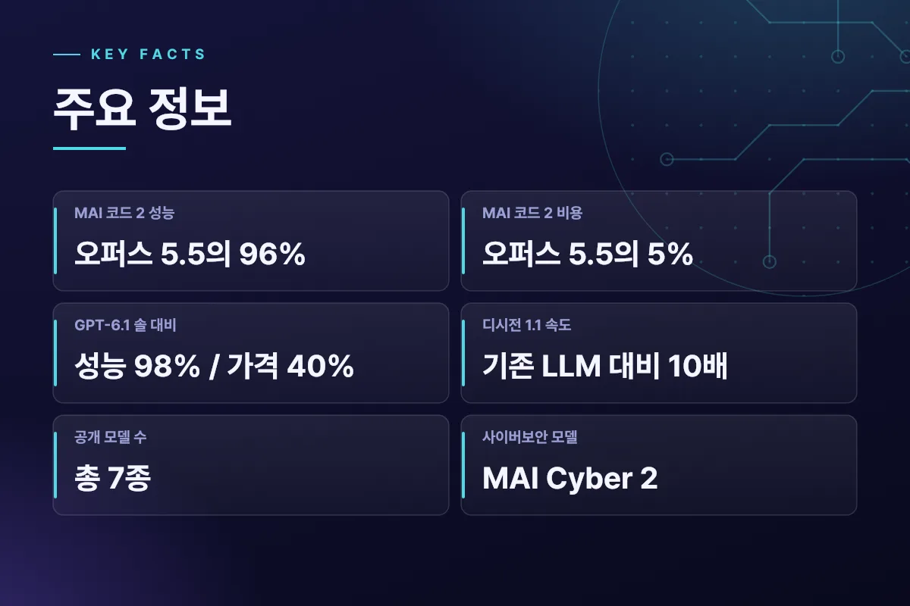
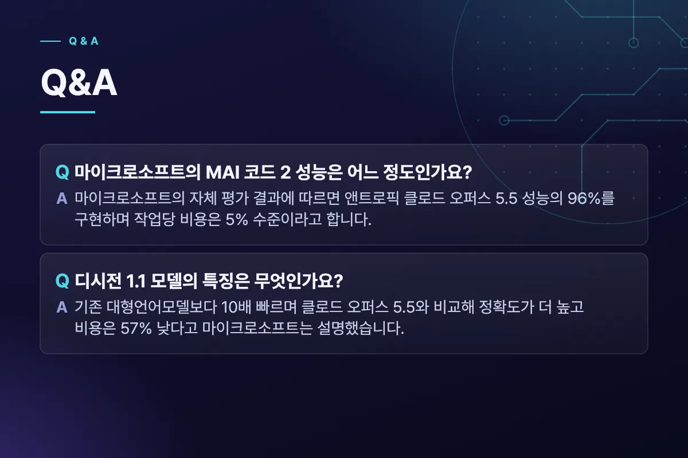
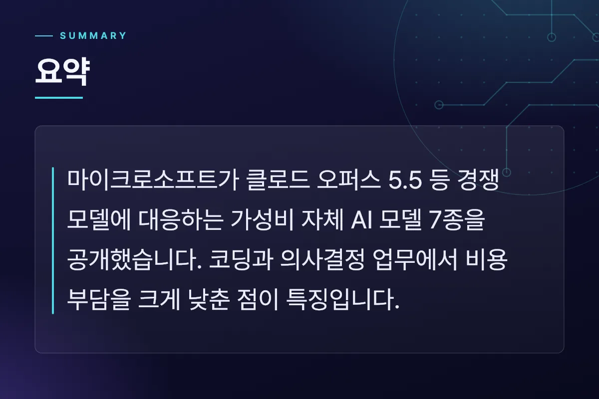
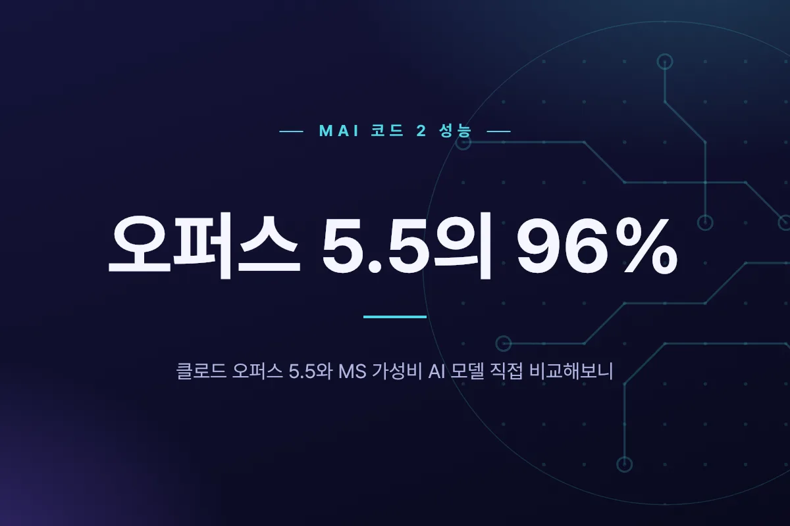
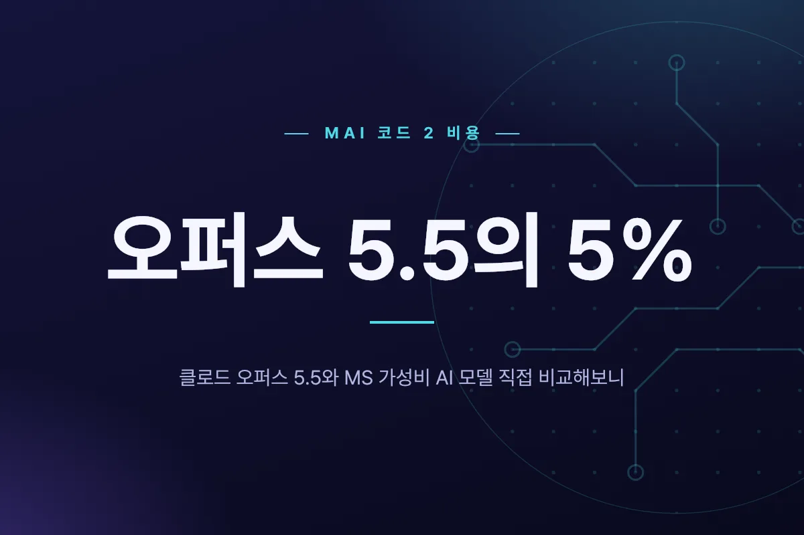

2026년 11월 18일 기준으로, 마이크로소프트가 앤트로픽의 '클로드 오퍼스 5.5'와 견줄 수 있는 자체 가성비 AI 모델들을 대거 공개하면서 개발자들과 기업들의 관심이 쏠리고 있습니다. 무스타파 술레이만 마이크로소프트 AI(MAI) 대표와 사티아 나델라 CEO 등이 발표한 이번 신모델 라인업은 비용 부담을 대폭 낮추면서도 기존 주요 모델에 버금가는 성능을 내세운 것이 특징입니다. 파이낸셜뉴스, 국민일보, 전자신문 등 국내 주요 언론의 2026년 11월 18일 보도 내용을 바탕으로 마이크로소프트가 공개한 코딩 및 의사결정 모델의 구체적인 수치와 비교 결과를 살펴봅니다.

<figure>

<figcaption>마이크로소프트 자체 AI 모델 공개 관련 주요 스펙</figcaption>
</figure>

마이크로소프트가 이번에 선보인 모델 중 가장 주목받는 분야는 코딩과 개발 지원 영역입니다. 매일경제와 뉴스1 등 2026년 11월 18일 보도에 따르면, 마이크로소프트는 코딩 특화 모델인 'MAI 코드 2'를 비롯해 규모가 작고 처리 속도가 빠른 'MAI 코드 2 플래시'를 함께 공개했습니다. 이 모델들은 여러 파일에 걸친 코드 수정과 복잡한 오류 분석, 프로그램 개발 등을 지원하는 능력을 갖추고 있습니다. 기업들이 일상적으로 마주하는 개발 업무에서 토큰 지출이 급증하는 문제를 해결하기 위해 고안된 라인업입니다.

특히 기업 고객들이 가장 민감하게 여기는 토큰 지출과 비용 효율성 측면에서 구체적인 비교 수치가 제시되었습니다. 디지털타임스와 머니투데이강원 등 2026년 11월 18일 보도에 따르면, MAI 코드 2는 일상적인 기업 개발 업무를 평가하는 4개 벤치마크 평균에서 오픈AI 'GPT-6.1 솔' 성능의 98%를 40% 가격에 구현합니다. 또한 앤트로픽의 '클로드 오퍼스 5.5'와 비교했을 때는 성능이 96%에 달하면서도 작업당 비용은 5% 수준에 불과하다고 마이크로소프트는 설명했습니다. 경쟁 모델과 비교해 각각 약 60%, 95% 저렴한 셈이며, 성능 차이는 크지 않으면서 비용 부담을 크게 줄였다는 평가를 받고 있습니다.

<figure>

<figcaption>클로드 오퍼스 5.5 대비 성능 96%와 비용 5% 수준 달성</figcaption>
</figure>

다만 이러한 비용 효율성 수치와 성능 평가는 마이크로소프트 자체 평가 결과를 바탕으로 하고 있으며, 일부 할인 가격 등이 반영된 결과라는 점을 염두에 둘 필요가 있습니다. 국민일보 2026년 11월 18일 보도에 따르면, 최고정보책임자(CIO)와 최고재무책임자(CFO)들이 토큰 지출이 치솟는 상황에 부담을 느끼고 있다는 점을 무스타파 술레이만 MAI 대표가 직접 언급하기도 했습니다. 성능을 일정 수준 이상 유지하면서도 비용을 절감하려는 기업 고객의 수요를 정조준한 것으로 풀이됩니다. 사이버보안 특화 모델인 'MAI Cyber 2'를 포함해 총 7종의 모델이 공개된 배경에도 이러한 비용 절감 요구가 자리 잡고 있습니다.

코딩 모델 외에도 속도와 효율을 극대화한 '디시전 1.1' 모델 역시 함께 공개되었습니다. ZD넷 코리아 2026년 11월 18일 보도에 따르면, 디시전 1.1은 기존 LLM보다 10배 빠르고 비용은 200분의 1 수준으로 구현되었습니다. 비교 대상인 클로드 오퍼스 5.5 등 경쟁 모델보다 5.4%포인트 높은 정확도를 보였으며, 오퍼스 5.5 대비 비용은 57% 낮았다는 설명이 덧붙였습니다. 사티아 나델라 CEO는 자사 모델뿐만 아니라 외부 AI 모델도 함께 활용하는 멀티모델 전략을 지속하겠다는 입장을 밝혔습니다.

<figure>

<figcaption>기존 LLM 대비 10배 빠른 속도와 비용 구조</figcaption>
</figure>

이번 발표는 오픈AI와 앤트로픽 등 기존 빅테크 중심의 AI 시장에서 마이크로소프트가 자체 모델을 통해 독자적인 입지를 다지려는 시도로 해석됩니다. 오픈아이 역시 신규 모델을 출시하며 API 가격을 인하하는 등 경쟁이 치열해지는 양상입니다. 강원도민일보 등 2026년 11월 18일 보도에 따르면 오픈아이의 'GPT-6.2 아스트라' 출시와 구글의 '제미나이 4 카본' 등과의 성능 경쟁 속에서, 마이크로소프트는 '가성비'를 무기로 기업 고객의 선택지를 넓히고 있습니다. 앤트로픽의 클로드 오퍼스 5.5를 겨냥한 이번 가성비 모델 공세가 향후 기업용 AI 시장에 어떤 변화를 가져올지 주목됩니다.

<figure>

<figcaption>MAI 코드 2 성능: 오퍼스 5.5의 96%</figcaption>
</figure>

다만 이러한 벤치마크 결과와 비용 절감 폭은 기업별 실제 도입 환경이나 사용 패턴에 따라 다르게 나타날 수 있습니다. 마이크로소프트가 공개한 자체 평가 수치는 참고하되, 실제 업무 환경에서의 적용 여부는 개별 기업의 인프라와 요구 사항에 맞춰 신중하게 검토해야 합니다. 사이버보안 특화 모델인 'MAI Cyber 2'를 포함해 총 7종의 모델이 공개된 만큼, 각 모델의 구체적인 활용 목적에 따른 세부 정책은 공식 문서와 공지를 통해 확인하는 것이 안전합니다. 앞으로 각 빅테크 기업들이 내놓는 추가 가격 정책과 성능 검증 결과에 따라 기업들의 선택도 달라질 것으로 보입니다.

<figure>

<figcaption>MAI 코드 2 비용: 오퍼스 5.5의 5%</figcaption>
</figure>

## 참고한 자료

- [MS "클로드급 코딩AI를 10분의 1 가격으로"...신모델 AI 7종 공개글로벌...](https://www.fnnews.com/news/202611180759315296) — fnnews.com, 2026-11-18 보도
- [“오픈AI 성능 98%에 비용은 반값”… MS, ‘가성비’ AI로 시장 공략](https://www.kmib.co.kr/article/20261118501589) — kmib.co.kr, 2026-11-18 보도
- [MS "코파일럿은 업무용 OS"… 가성비 AI모델들로 경쟁 본격화](https://www.dt.co.kr/article/12095820?ref=naver) — dt.co.kr, 2026-11-18 보도
- [MS, ‘가성비 AI’ 공세...GPT급 코딩 성능에 비용 40%](https://www.mk.co.kr/article/12211911) — 매일경제, 2026-11-18 보도
- [MS, 디시전 1.1 공개…"기존 LLM보다 10배 빠르고 비용은 200분의 1"](https://zdnet.co.kr/view/?no=20261118060848) — zdnet.co.kr, 2026-11-18 보도
- ["오픈AI 성능 98%에 비용은 절반"…'홀로서기' 나선 MS, 자체 AI 모델 7종...](https://www.newsis.com/view/NISX20261118_0003872382) — 뉴시스, 2026-11-18 보도

2026년 11월 18일 기준으로 정리했습니다. 일정이나 금액처럼 바뀔 수 있는 내용은 위 참고 자료에서 한 번 더 확인해 주세요.
