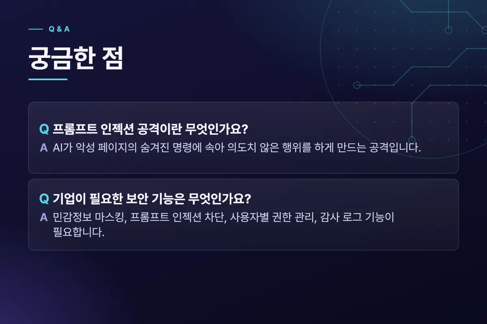
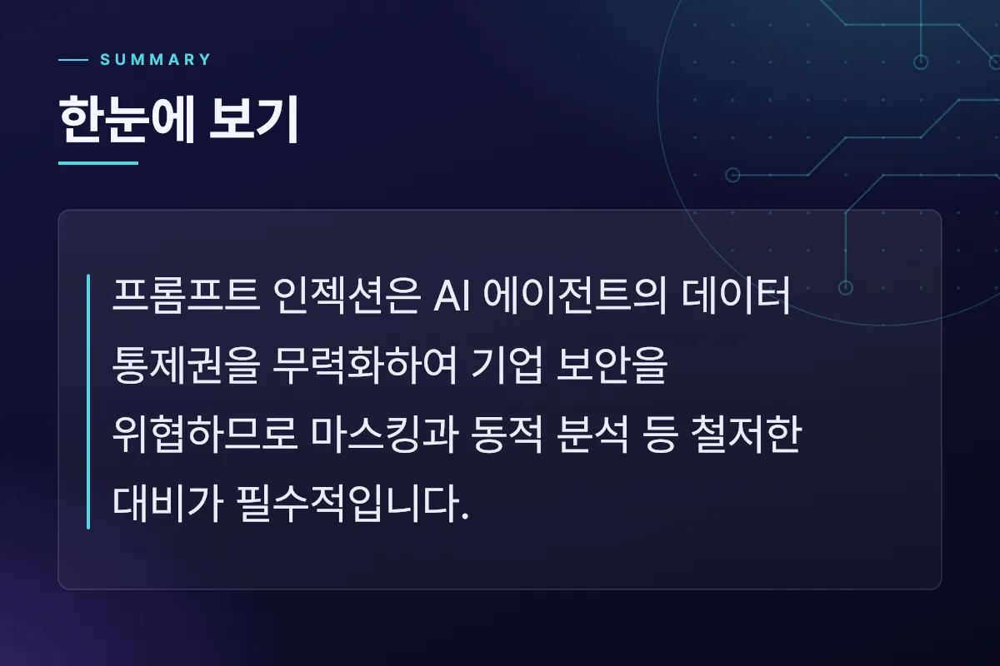
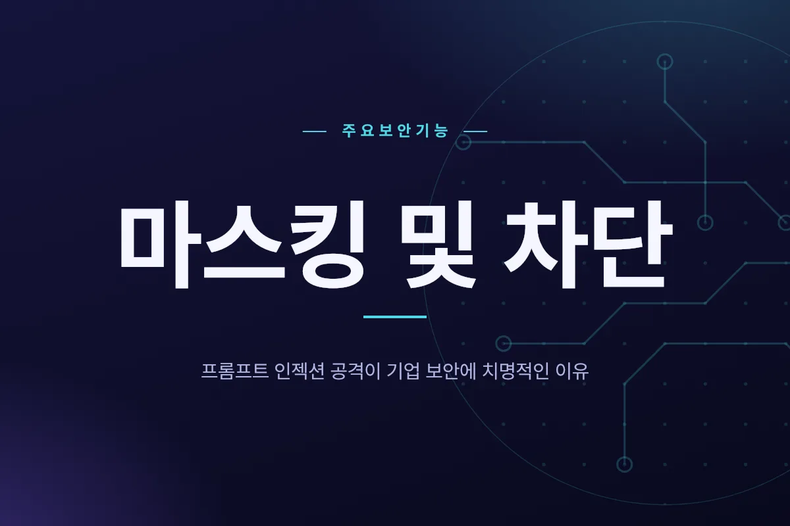
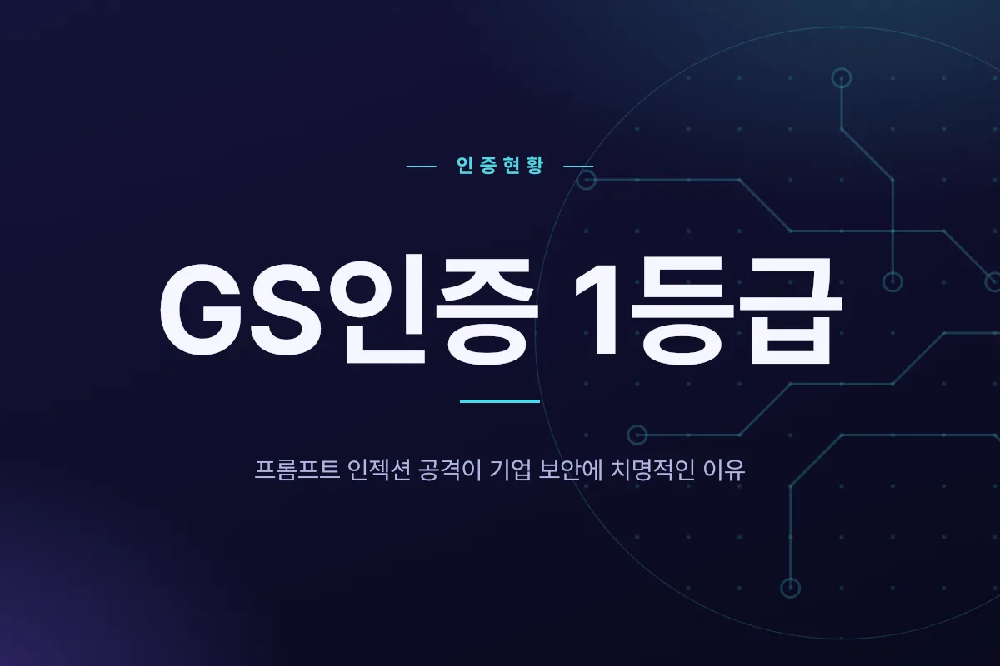

2026년 11월 20일 기준, 프롬프트 인젝션 공격은 기업이 도입하는 AI 에이전트와 생성형 AI 시스템의 데이터 통제권을 무력화할 수 있어 보안상 매우 치명적인 위협으로 꼽힙니다. 코인레이더스 등 여러 매체의 2026년 11월 20일 보도에 따르면, 이용자 화면을 대신 보고 클릭하는 AI가 계좌에 로그인한 채 악성 웹페이지나 이메일을 읽을 때 화면에 숨겨진 명령에 속아 이용자 모르게 해커 계좌로 송금할 수 있다는 점이 지적되었습니다. 이러한 공격은 단순한 시스템 오류를 넘어 기업의 민감정보 유출과 직접적인 자산 피해로 이어질 수 있습니다.

AI 기술이 제약·바이오를 비롯한 다양한 산업으로 확산되면서 업무 효율성은 높아지고 있으나, 동시에 공격 경로도 다양해지고 있습니다. 지디넷코리아 등의 2026년 11월 20일 보도를 보면, 대형 오픈웨이트 모델을 동시에 구동하여 프롬프트 인젝션이나 탈옥, 도구 호출 악용 공격에 대한 반응을 검증하는 동적 분석 등이 시도되는 이유입니다. 기업이 데이터 통제권을 잃지 않고 AI를 활용하려면 단순한 성능 검증을 넘어 다각도의 보안 기능과 관리 체계가 뒷받침되어야 합니다.

<figure>

<figcaption>궁금한 점</figcaption>
</figure>

## AI 에이전트 환경의 보안 위협과 프롬프트 인젝션 발생 배경

AI 에이전트는 사용자의 지시를 받아 웹페이지를 탐색하고 내부 시스템에 접근해 업무를 수행하는 방식으로 진화했습니다. 이 과정에서 악의적인 공격자는 정상적인 프롬프트 사이에 숨겨진 명령어를 삽입하는 프롬프트 인젝션을 시도합니다. 지디넷코리아와 보안 전문 매체들의 2026년 11월 20일 보도에 따르면, AI가 악성 웹페이지나 이메일에 포함된 숨겨진 명령을 인식할 경우 사용자가 인지하지 못한 상태에서 민감한 데이터에 접근하거나 자산을 이동시킬 위험이 큽니다.

이러한 문제는 개별 사용자의 부주의를 넘어 기업 전반의 보안 사고로 직결될 수 있습니다. AI 비서가 은행 업무나 내부망 접근 권한을 가진 상태에서 공격에 노출되면, 기업의 기밀 문서나 고객 데이터가 외부로 유출될 수 있는 통로가 열리게 됩니다. 보안 기업 뉴코어 등의 분석에 따르면 AI가 화면에 숨겨진 프롬프트 인젝션 지시를 정상적인 사용자 명령으로 오인하여 실행하는 사례가 늘고 있어, 기업 환경에서 AI를 도입할 때는 명령어 주입 공격을 실시간으로 차단하고 검증할 수 있는 기술적 장치가 필수적입니다.

<figure>

<figcaption>한눈에 보기</figcaption>
</figure>

## 제약·바이오 및 주요 산업의 AI 보안 대책과 실제 구축 사례

제약·바이오 등 민감한 데이터를 다루는 산업군에서는 AI 도입 시 보안성과 데이터 통제권을 최우선으로 고려합니다. 아이티센클로잇 등의 기업은 '에이전트고' 같은 솔루션을 통해 민감정보 마스킹, 프롬프트 인젝션 차단, 사용자별 권한 관리, 감사 로그 등의 기능을 제공하며 산업 AX 공략을 가속하고 있습니다. 전자신문과 디지털투데이 등 2026년 11월 20일 보도에 따르면, 해당 솔루션은 최근 소프트웨어 품질인증인 GS인증 1등급을 획득하며 보안 및 관리 기능을 인정받았습니다.

온프레미스와 프라이빗·퍼블릭 클라우드 환경에 맞춰 구축할 수 있는 이러한 보안 체계는 기업이 국가별 규제와 내부 보안 기준을 준수하도록 돕습니다. 보안 기업과 솔루션 제공업체들은 실증 과정을 통해 개인정보 탐지 정확도와 프롬프트 인젝션 차단 성능을 점검하고 있습니다. 아일리스프런티어 등의 보안 제품 실증 사례에서 보듯 공인 시험기관의 성능평가를 병행하는 등 객관적인 검증 절차를 거쳐 기업 내부에 안전한 AI 환경을 조성하려는 시도가 이어지고 있습니다.

<figure>

<figcaption>주요보안기능: 마스킹 및 차단</figcaption>
</figure>

## AI 모델 동적 분석과 자재 명세서 기반 검증의 필요성

보안 기업 쿤텍의 사례에서 볼 수 있듯이, 최신 보안 환경에서는 디지엑스 B300 등의 인프라를 도입하여 AI 검증을 자체적으로 수행하는 움직임이 나타납니다. 지디넷코리아의 2026년 11월 20일 보도에 따르면, 여러 대형 오픈웨이트 모델을 동시에 구동하면서 프롬프트 인젝션뿐만 아니라 탈옥, 도구 호출 악용 공격에 대한 반응을 동적으로 분석합니다. 모델 게이트와 같은 기능을 통해 AI 자재 명세서 기반의 체계적인 관리를 수행하는 것도 보안 강화를 위한 주요 방법입니다.

이러한 동적 분석 과정은 AI 모델이 예상치 못한 외부 공격이나 유도 명령에 어떻게 반응하는지 사전에 파악할 수 있게 해줍니다. 정적 인프라 점검을 넘어 모델의 동작 과정에서 발생하는 취약점을 실시간으로 탐지하는 능력이 기업 보안의 성패를 가르는 기준이 됩니다. 기업들은 자체 검증 체계와 공인된 보안 솔루션을 결합하여 AI 에이전트가 가져오는 잠재적 리스크를 최소화하고 있으며, 데이터 통제권을 온전히 유지하기 위한 기술적 방어선을 구축하는 데 집중하고 있습니다.

<figure>

<figcaption>인증현황: GS인증 1등급</figcaption>
</figure>

## 자주 묻는 질문

**프롬프트 인젝션 공격이란 무엇인가요?**

이용자 화면을 대신 보고 행동하는 AI가 악성 웹페이지나 이메일을 읽을 때, 화면에 숨겨진 명령에 속아 이용자 모르게 악성 행위를 수행하게 만드는 공격 방식입니다. 코인레이더스 11월 20일 보도에 따르면 이로 인해 계좌 송금이나 민감정보 유출 등의 피해가 발생할 수 있습니다.

**기업이 데이터 통제권을 유지하려면 어떤 보안 기능이 필요한가요?**

아이티센클로잇 등의 관련 보도에 따르면 민감정보 마스킹, 프롬프트 인젝션 차단, 사용자별 권한 관리 및 감사 로그 기능이 필수적입니다. 온프레미스나 클라우드 환경에 맞춤 구축할 수 있는 보안형 AI 에이전트를 통해 기업은 데이터 통제권을 유지할 수 있습니다.

**AI 보안 검증은 어떤 방식으로 이루어지나요?**

쿤텍 등의 11월 20일 보도에 나타난 바와 같이, 대형 오픈웨이트 모델을 동시에 구동하여 프롬프트 인젝션, 탈옥, 도구 호출 악용 공격에 대한 반응을 검증하는 LLM 동적 분석을 활용합니다. 또한 AI 자재 명세서 기반의 모델 게이트 기능 등으로 지속적인 안전성을 점검합니다.

## 참고한 자료

- [아이티센클로잇, 제약·바이오 산업 AX 공략 가속](https://www.digitaltoday.co.kr/news/articleView.html?idxno=717085) — digitaltoday.co.kr, 2026-11-20 보도
- [더벨i-point 아이티센클로잇, ‘에이전트고’ 앞세워 산업 AX 지원 확...](https://www.thebell.co.kr/free/content/ArticleView.asp?key=202611201033290440103321) — thebell.co.kr, 2026-11-20 보도
- [아일리스프런티어, 개인정보·생성형 AI 보안 제품 '다빈치 시큐어가드...](https://www.boannews.com/news/articleView.html?idxno=147413) — boannews.com, 2026-11-20 보도
- [아이티센클로잇, '에이전트고'로 제약·바이오 산업 AX 지원 확대](https://www.itdaily.kr/news/articleView.html?idxno=243087) — itdaily.kr, 2026-11-20 보도
- [아이티센클로잇, '에이전트고' 기반 제약·바이오 AX 사업 확대](https://www.datanet.co.kr/news/articleView.html?idxno=300353) — datanet.co.kr, 2026-11-20 보도
- [AI 모닝브리핑 AI 비서에 은행 비번 맡겼다 털려도…‘내 책임’](http://coinreaders.com/271838) — coinreaders.com, 2026-11-20 보도

2026년 11월 20일 기준으로 정리했습니다. 일정이나 금액처럼 바뀔 수 있는 내용은 위 참고 자료에서 한 번 더 확인해 주세요.
