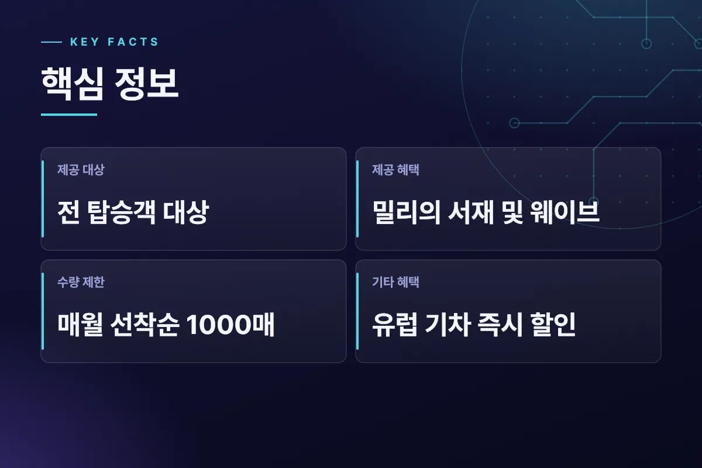
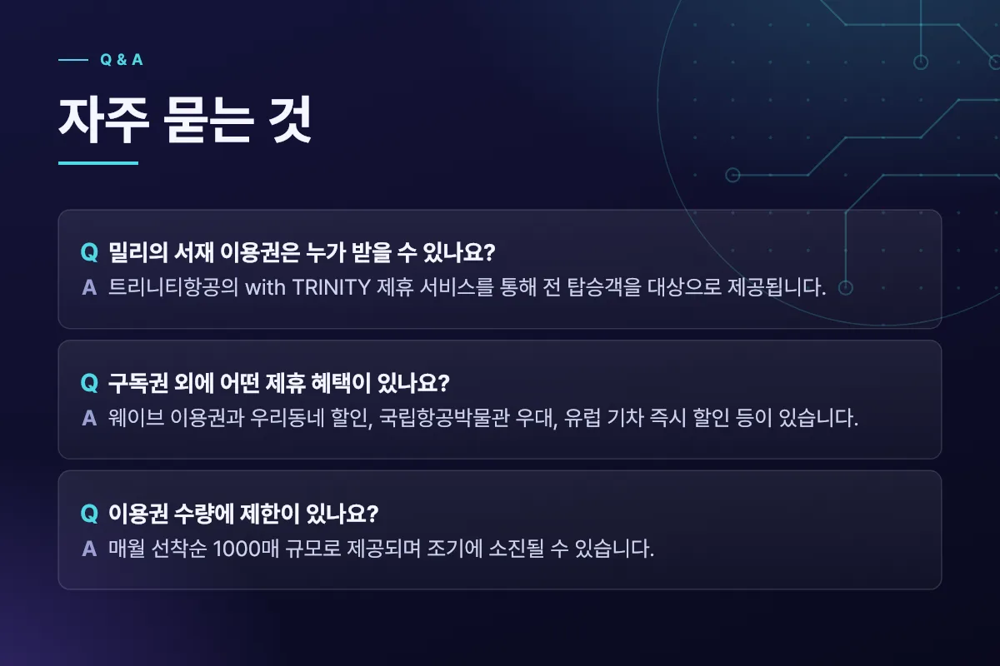
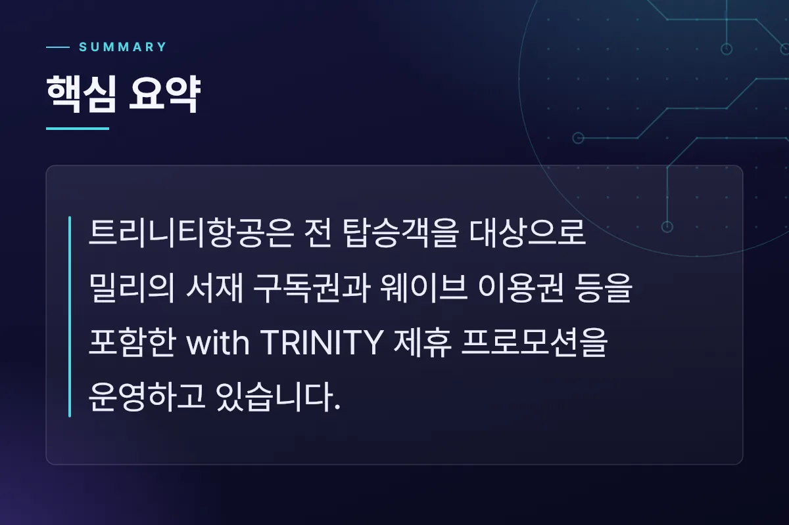

2026년 11월 18일 기준, 트리니티항공은 신규 회원과 탑승객을 대상으로 다양한 제휴 프로모션을 진행하고 있습니다. 이번 프로모션에는 전자책 구독 플랫폼인 밀리의 서재 구독권과 온라인 동영상 서비스 웨이브 이용권 등이 포함되어 있어 주목받고 있습니다. 항공 이동 수단에 디지털 콘텐츠 소비 경험을 결합한 형태의 마케팅이 어떤 방식으로 구성되어 있는지 구체적인 내용을 살펴보는 것이 도움이 됩니다.

<figure>

<figcaption>트리니티항공 제휴 프로모션 주요 제공 항목</figcaption>
</figure>

### 트리니티항공 프로모션의 주요 제휴 혜택 내용

한경비즈니스와 씨에스티메디아 등의 보도에 따르면, 트리니티항공은 전 탑승객을 대상으로 'with TRINITY' 제휴 서비스를 운영하고 있습니다. 이 서비스를 통해 탑승객들은 웨이브(Wavve) 이용권과 함께 밀리의 서재 구독권을 제공받을 수 있습니다. 이동 중이나 여행지에서 즐길 수 있는 디지털 콘텐츠 이용권을 탑승객 혜택으로 연계한 점이 특징입니다. 

해당 혜택은 매월 선착순 1000매 규모로 제공되며, 조기 소진될 정도로 이용자들의 호응을 얻고 있습니다. 아울러 우리동네 할인 프로모션을 비롯해 국립항공박물관 우대 요금, 유럽 기차 즉시 할인 등 다양한 연계 혜택도 함께 구성되어 있습니다. 세부적인 적용 조건이나 이용 방법은 트리니티항공 공식 홈페이지를 통해 확인할 수 있으므로, 탑승을 계획 중인 이용자라면 사전에 공지사항을 살펴보는 편이 좋습니다.

<figure>

<figcaption>트리니티항공 제휴 혜택 관련 Q&amp;A</figcaption>
</figure>

### 독서 플랫폼과 교통·유통 업계의 협업 배경

최근 유통 및 교통 업계에서는 독서 문화와 결합한 마케팅을 다방면으로 전개하고 있습니다. 스마트에스알에스와이드경제 등의 보도에 따르면, 밀리의 서재는 광양시 중앙도서관의 청년 특화 독서서비스 지원 확대에 참여하거나, 유통 업계와 협업한 상품을 선보이는 등 여러 분야와의 접점을 넓히고 있습니다. 오디오북과 전자책 서비스가 대중화되면서 다양한 산업군에서 독서 플랫폼과의 협업을 시도하는 추세입니다.

이러한 흐름 속에서 항공사인 트리니티항공 역시 탑승객 경험을 다각화하기 위해 디지털 콘텐츠 플랫폼과의 제휴를 선택한 것으로 분석됩니다. 오디오북과 전자책 서비스에 대한 대중의 관심이 높아짐에 따라, 이동 중이나 휴식 시간에 즐길 수 있는 구독권을 실질적인 탑승 혜택으로 구성한 것입니다. 단순한 이동 수단 제공을 넘어 체류 시간 동안 즐길 거리를 함께 제공하려는 시도가 이어지고 있습니다.

<figure>

<figcaption>트리니티항공 프로모션 및 혜택 요약</figcaption>
</figure>

### 자주 묻는 질문

**Q. 밀리의 서재 이용권은 누구나 받을 수 있나요?**

트리니티항공의 'with TRINITY' 제휴 서비스를 통해 전 탑승객을 대상으로 제공되고 있습니다. 다만 매월 선착순 1000매 한정으로 운영되므로 조기에 마감될 수 있습니다.

**Q. 구독권 외에 어떤 제휴 혜택이 함께 제공되나요?**

웨이브 이용권을 비롯해 우리동네 할인 프로모션, 국립항공박물관 우대 요금, 유럽 기차 즉시 할인 등이 함께 운영되고 있습니다.

**Q. 프로모션의 자세한 이용 방법은 어디서 확인하나요?**

세부적인 내용과 적용 기준은 트리니티항공 공식 홈페이지를 통해 직접 확인할 수 있습니다.

[관련 링크 확인하기](https://bitl.bz/Ulrkbx)

## 참고한 자료

- [트리니티항공, 태국 공동 프로모션...신규 회원 대상 혜택 마련](http://www.hansbiz.co.kr/news/articleView.html?idxno=884394) — hansbiz.co.kr, 2026-11-18 보도
- [글로벌 빅테크, 오디오북 시장 정조준…유튜브·아마존 가세에 국내 업...](https://www.widedaily.com/news/articleView.html?idxno=303999) — widedaily.com, 2026-11-18 보도
- [소비자의 선택 '간판 바꾸고 훨훨' 트리니티항공, 노선 확장·맞춤 혜...](https://www.cstimes.com/news/articleView.html?idxno=728268) — cstimes.com, 2026-11-18 보도
- [광양시 중앙도서관, '청년 특화' 독서서비스 확대](https://www.jnilbo.com/news/articleView.html?idxno=90000083718) — jnilbo.com, 2026-11-18 보도
- [국민연금공단, 신임 상임감사에 이종렬 前 한국은행 부총재보 임명](https://www.cstimes.com/news/articleView.html?idxno=728437) — cstimes.com, 2026-11-18 보도
- [문학 작품 옷 입은 먹거리와 굿즈…'텍스트힙' 동참하는 유통업계](http://www.srtimes.kr/news/articleView.html?idxno=218001) — srtimes.kr, 2026-11-18 보도

2026년 11월 18일 기준으로 정리했습니다. 일정이나 금액처럼 바뀔 수 있는 내용은 위 참고 자료에서 한 번 더 확인해 주세요.
